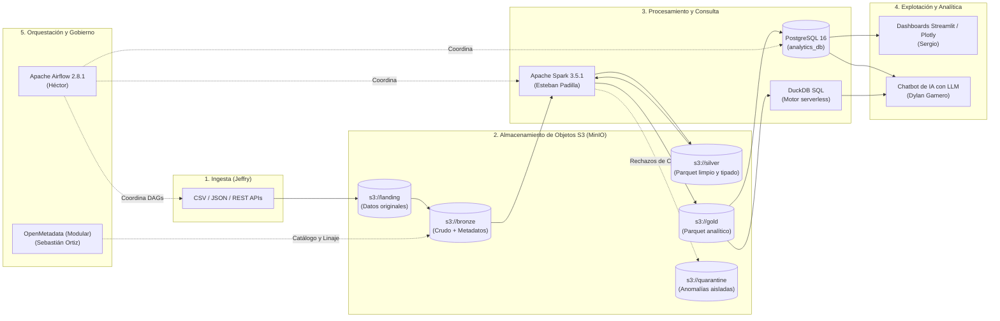

# Plataforma Extensible de Datos — Arquitectura Medallion


-success)

Infraestructura base, orquestación y contratos de integración técnica para la plataforma analítica Lakehouse basada en **Arquitectura Medallion**. Diseñada para procesar datos de retail/e-commerce y servir indicadores confiables tanto a **Dashboards interactivos** como a un **Chatbot de Analítica con Inteligencia Artificial**.

---

## 1. Visión General y Arquitectura

La arquitectura implementa el flujo de refinamiento continuo de datos de Medallion:



---

## 2. Tecnologías y Responsabilidades del Equipo

| Integrante | Rol Principal | Rama Git Asignada | Módulo Técnico |
| :--- | :--- | :--- | :--- |
| **Luis Gómez** | Sublíder & Arquitecto Técnico | `feature/arquitectura-base` | Infraestructura Docker, base de datos, contratos, pipeline E2E y utilidades comunes. |
| **Jeffry** | Ingeniero de Ingesta | `feature/ingesta-minio` | Conectores CSV/JSON, APIs REST y depósito en Landing/Bronze (`src/ingestion`). |
| **Esteban Padilla** | Ingeniero Spark / Data | `feature/spark-medallion` | Procesamiento PySpark Bronze -> Silver -> Gold, particionado y optimización (`src/silver`, `src/gold`). |
| **Héctor** | Ingeniero de Orquestación | `feature/airflow-orquestacion` | DAGs de producción en Airflow, SLAs, alertas y gestión de dependencias (`dags/`). |
| **Sebastián Ortiz** | Calidad & Gobernanza | `feature/calidad-gobierno` | Reglas de validación, Quarantine, linaje de datos y catálogo OpenMetadata (`src/quality`). |
| **Sergio** | Ingeniero de Visualización | `feature/dashboard` | Dashboards interactivos en Streamlit / Plotly sobre capa Gold. |
| **Dylan Gamero** | Líder de Proyecto & Chatbot IA | `feature/chatbot-ia` | API FastAPI, integración LLM y consultas en lenguaje natural respaldadas por SQL real. |

---

## 3. Estructura del Proyecto

```
Pipeline-analitica/
├── docker-compose.yml              # Orquestación de MinIO, Spark, Postgres y Airflow
├── .env.example                    # Plantilla documentada de variables de entorno
├── .gitignore                      # Exclusiones de Git (secretos, venv, caches, logs)
├── pyproject.toml                  # Configuración de empaquetado y pytest
├── requirements.txt                # Dependencias de Python del proyecto
├── README.md                       # Documentación maestra del repositorio
├── .github/
│   └── pull_request_template.md    # Plantilla obligatoria para Pull Requests
├── config/
│   └── settings.yaml               # Configuración declarativa de buckets, reglas y Spark
├── infrastructure/
│   ├── postgres/
│   │   └── init-databases.sh       # Inicializador de bases airflow_db y analytics_db
│   ├── minio/
│   │   ├── init_buckets.py         # Inicializador automático de buckets Medallion
│   │   └── init-buckets.sh         # Script alternativo mc
│   ├── spark/
│   │   └── spark-defaults.conf     # Configuración S3A para conexión MinIO-Spark
│   └── governance/
│       └── docker-compose.governance.yml # Módulo desacoplado para OpenMetadata
├── src/
│   ├── common/                     # Configuración, S3 Client, DB Client y Logging
│   ├── ingestion/                  # BaseConnector, LandingIngestor y MockDataGenerator
│   ├── bronze/                     # BronzeLoader con inmutabilidad y metadatos SHA256
│   ├── silver/                     # SilverTransformer (tipado, deduplicación, Parquet)
│   ├── gold/                       # GoldAggregator (KPIs diarios y Data Mart Postgres)
│   └── quality/                    # DataQualityValidator (reglas y segregación Quarantine)
├── dags/
│   └── medallion_pipeline_dag.py   # DAG de producción para Apache Airflow
├── tests/
│   ├── conftest.py                 # Fixtures de Pytest
│   ├── test_config.py              # Tests de configuración
│   ├── test_ingestion.py           # Tests de generación sintética e ingesta
│   ├── test_quality.py             # Tests de reglas de calidad y umbrales Quarantine
│   └── test_transformations.py     # Tests de tipado Silver y cálculos analíticos Gold
├── scripts/
│   ├── init_env.sh                 # Script bash de inicialización del entorno
│   ├── run_pipeline_local.sh       # Ejecutor E2E del pipeline Medallion local
│   ├── run_pipeline_local.py       # Script Python del runner de integración
│   └── check_health.sh             # Diagnóstico de salud de contenedores y puertos
└── docs/
    ├── arquitectura.md             # Especificación técnica detallada de la arquitectura
    ├── contratos_integracion.md    # Contratos de esquemas, rutas y APIs entre compañeros
    └── guia_desarrollo.md          # Guía de onboarding, Git Flow y buenas prácticas
```

---

## 4. Requisitos y Configuración Inicial (Linux)

### 4.1 Requisitos del Sistema
- **Sistema Operativo:** Linux (Ubuntu 22.04+ recomendado).
- **Docker Engine:** Versión 24.0+ (`docker --version`).
- **Docker Compose:** Versión v2.20+ (`docker compose version`).
- **Python:** 3.10 o superior (`python3 --version`).
- **RAM Disponible:** Mínimo 4 GiB disponibles.

### 4.2 Paso a Paso de Inicialización
```bash
# 1. Clonar el repositorio y situarse en la carpeta
git clone https://github.com/dypok/Pipeline-analitica.git
cd Pipeline-analitica

# 2. Crear y activar entorno virtual Python
python3 -m venv .venv
source .venv/bin/activate

# 3. Instalar requerimientos del proyecto
pip install --upgrade pip
pip install -r requirements.txt

# 4. Crear archivo .env local a partir de la plantilla
cp .env.example .env
```

> [!NOTE]
> **Mitigación de Conflicto de Puerto PostgreSQL:** Si en tu host ya corre PostgreSQL en el puerto `5432`, nuestro contenedor de PostgreSQL expone el puerto **`5433`** hacia el host (`localhost:5433`). Internamente en la red Docker se comunican transparentemente a `postgres:5432`.

---

## 5. Gestión de Infraestructura con Docker Compose

### 5.1 Levantar los Servicios en Segundo Plano
```bash
docker compose up -d
```

### 5.2 Servicios y Endpoints Disponibles
| Servicio | URL / Host | Puerto Host | Credenciales por Defecto |
| :--- | :--- | :--- | :--- |
| **Apache Airflow Web UI** | [http://localhost:8080](http://localhost:8080) | `8080` | `admin` / `admin` |
| **MinIO Console (S3 UI)** | [http://localhost:9001](http://localhost:9001) | `9001` | `minioadmin` / `miniopassword123` |
| **MinIO API S3** | [http://localhost:9000](http://localhost:9000) | `9000` | `minioadmin` / `miniopassword123` |
| **Apache Spark Master UI** | [http://localhost:8081](http://localhost:8081) | `8081` | N/A |
| **PostgreSQL Data Mart** | `localhost` | `5433` | `medallion_user` / `medallion_secret` (`analytics_db`) |

### 5.3 Diagnóstico de Salud
```bash
./scripts/check_health.sh
```

### 5.4 Detener la Infraestructura
```bash
# Detener contenedores preservando datos:
docker compose down

# Detener eliminando datos de volúmenes:
docker compose down -v
```

---

## 6. Ejecución del Flujo de Demostración E2E

### Opción A: Ejecución Local Directa (Recomendada para pruebas rápidas y CI)
```bash
./scripts/run_pipeline_local.sh
```
*Este comando genera órdenes sintéticas, las ingesta en MinIO Landing, promueve a Bronze, transforma a Silver en Parquet Snappy, desvía registros anómalos a Quarantine, calcula indicadores Gold de ventas y los sincroniza en la tabla PostgreSQL `analytics.daily_sales_kpis`.*

### Opción B: Ejecución Orquestada en Apache Airflow
1. Abre [http://localhost:8080](http://localhost:8080) e inicia sesión (`admin` / `admin`).
2. Localiza el DAG **`medallion_pipeline_e2e`**.
3. Haz clic en **Trigger DAG** (o ejecútalo vía terminal):
   ```bash
   docker exec medallion-airflow-scheduler airflow dags trigger medallion_pipeline_e2e
   ```
4. Monitorea la ejecución secuencial de sus 6 tareas:
   - `generate_mock_data` -> `ingest_to_landing` -> `load_to_bronze` -> `transform_to_silver` -> `aggregate_to_gold` -> `audit_and_log`.

---

## 7. Ejecución de Pruebas Automatizadas

El proyecto cuenta con una suite completa de pruebas unitarias y de integración en `tests/`:

```bash
pytest -v
```

---

## 8. Diagnóstico de Logs y Troubleshooting

### Consultar Logs de un Contenedor Específico:
```bash
docker logs -f medallion-airflow-scheduler
docker logs -f medallion-spark-master
docker logs -f medallion-postgres
docker logs -f medallion-minio
```

### Consultar Datos Directamente en PostgreSQL:
```bash
docker exec -it medallion-postgres psql -U medallion_user -d analytics_db -c "SELECT * FROM analytics.daily_sales_kpis LIMIT 10;"
```

### Consultar Contenido de Buckets en MinIO:
```bash
python3 -c "
from src.common.s3_client import S3Client
s3 = S3Client(endpoint_url='http://localhost:9000')
for b in ['landing', 'bronze', 'silver', 'gold', 'quarantine']:
    print(f'Bucket {b}:', s3.list_objects(b))
"
```

---

## 9. Convenciones de Git y Trabajo del Equipo

Seguimos el flujo **Git Flow**:
- **`main`:** Versión estable lista para release.
- **`develop`:** Rama de integración continua del equipo.
- **`feature/<nombre>`:** Rama individual de cada integrante.

### Cómo Iniciar tu Trabajo:
```bash
# 1. Asegúrate de estar en develop y actualizado
git checkout develop
git pull origin develop

# 2. Crea tu rama feature (ejemplo para Jeffry)
git checkout -b feature/ingesta-minio develop

# 3. Desarrolla y ejecuta pruebas antes de confirmar
pytest -v

# 4. Entrega mediante Pull Request hacia develop en GitHub
```

---

## 10. Módulo de Gobernanza (OpenMetadata)

Para evitar saturar la memoria RAM en máquinas locales de desarrollo (requiere 4-6 GiB adicionales), OpenMetadata se encuentra modularizado en:
```bash
# Despliegue opcional de OpenMetadata:
docker compose -f docker-compose.yml -f infrastructure/governance/docker-compose.governance.yml up -d
```
Documentación detallada en [`docs/arquitectura.md`](file:///home/Coder/Escritorio/trabajo%20de%20analisis/Pipeline-analitica/docs/arquitectura.md).

---

## 11. Limitaciones Conocidas y Siguientes Pasos

1. **Datos:** El generador actual simula datos de Retail/E-commerce con casos de anomalía controlada. El siguiente paso es que **Jeffry** conecte fuentes reales (API REST y CSVs de producción).
2. **Spark:** Actualmente el job de transformación corre optimizado con PyArrow/Pandas y un script SparkSubmit listo en `src/silver/spark_medallion_job.py`. **Esteban Padilla** ampliará los modelos analíticos `customer_360` y `product_performance`.
3. **Catálogo:** Se incorporará el conector de linaje de OpenMetadata a las tareas de Airflow una vez desplegado en el servidor de pruebas.
