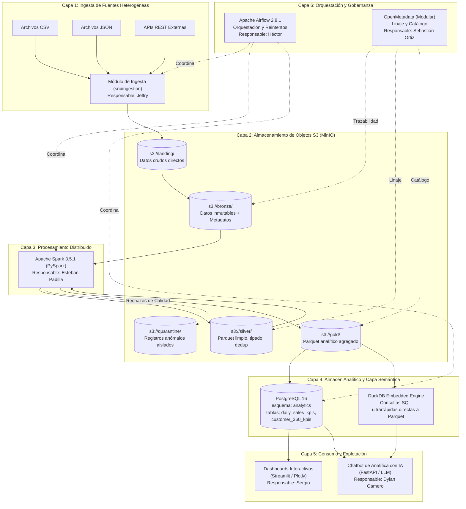

# ARQUITECTURA TÉCNICA E INFRAESTRUCTURA — MEDALLION PLATFORM

> **Autor:** Luis Gómez (Sublíder & Arquitecto Técnico)  
> **Proyecto:** Plataforma Extensible de Datos  
> **Fecha:** 19 de octubre de 2026  
> **Versión:** 1.0.0  

---

## 1. Visión y Alcance

La plataforma Medallion tiene como objetivo proporcionar una base técnica reproducible, escalable y modular para la ingesta, almacenamiento, procesamiento analítico y consulta conversacional de datos empresariales mediante Inteligencia Artificial.

---

## 2. Tecnologías y Roles en el Ecosistema

### 2.1 MinIO (Almacenamiento de Objetos Compatible con S3)
- **Imagen:** `minio/minio:RELEASE.2024-03-05T04-48-18Z`
- **Puertos:** `9000` (API S3) y `9001` (Consola Web interactiva).
- **Buckets inicializados automáticamente:** `landing`, `bronze`, `silver`, `gold`, `quarantine`.
- **Persistencia:** Volumen Docker dedicado `minio_data`.

### 2.2 Apache Spark (Motor de Transformación y Computación)
- **Imagen:** `apache/spark:3.5.1`
- **Master UI:** `http://localhost:8081` | **RPC Master:** `spark://spark-master:7077`.
- **Worker:** Asignación controlada de memoria (`2g`) y cores (`2`) para prevenir saturación de RAM.
- **Conexión a MinIO:** Protocolo `s3a://` mediante `Hadoop-AWS`.

### 2.3 PostgreSQL 16 (Metadatos y Data Mart Analítico)
- **Puerto expuesto al host:** **`5433:5432`** (mitigación técnica para evitar colisión con el PostgreSQL local del host).
- **Bases de datos independientes:**
  - `airflow_db`: Metadatos de tareas, ejecuciones, variables y conexiones de Airflow.
  - `analytics_db`: Data Mart de producción con schema `analytics`, tablas `daily_sales_kpis`, `customer_360_kpis` y tabla de auditoría `pipeline_execution_logs`.

### 2.4 Apache Airflow 2.8.1 (Orquestador de Pipelines)
- **Webserver UI:** `http://localhost:8080` (Credenciales por defecto: `admin / admin`).
- **Ejecutor:** `LocalExecutor` para máxima eficiencia y bajo consumo de recursos en desarrollo.
- **DAG inicial:** `medallion_pipeline_e2e` con reintentos configurados y registro en base de datos.

### 2.5 Evaluación y Estrategia de Gobernanza: OpenMetadata vs Apache Atlas
- **Comparativa Técnica:**
  - *Apache Atlas:* Basado en el stack legacy de Hadoop, requiere Apache HBase, Apache Solr y ZooKeeper, demandando más de 8-10 GiB de RAM solo para su inicialización. Su configuración en Docker es frágil y poco mantenible.
  - *OpenMetadata:* Arquitectura moderna cloud-native, basada en APIs REST y OpenAPI, con conectores nativos para Airflow y PySpark, interfaz web fluida y soporte directo de linaje a nivel de columna.
- **Decisión Arquitectónica:**
  - Se selecciona **OpenMetadata** como la plataforma oficial de gobierno y catálogo para el proyecto.
  - Para no saturar los 6.7 GiB disponibles en la máquina local de desarrollo durante las etapas iniciales, OpenMetadata se provisiona como un **módulo opcional desacoplado** (`infrastructure/governance/docker-compose.governance.yml`), listo para encenderse cuando se requiera sin bloquear el pipeline principal.

---

## 3. Seguridad y Variables de Entorno

- Toda la configuración se parametriza mediante `.env` (ignorado por Git).
- No se almacenan contraseñas en duro en los repositorios.
- Se proporciona `.env.example` con valores mock seguros para reproducción inmediata.
