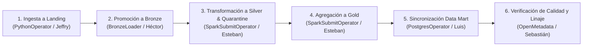

# CONTRATOS DE INTEGRACIÓN TÉCNICA — ARQUITECTURA MEDALLION

> **Proyecto:** Plataforma Extensible de Datos (Medallion Platform)  
> **Autor / Responsable:** Luis Gómez (Sublíder de Equipo — Arquitectura e Integración Técnica)  
> **Fecha:** 19 de octubre de 2026  
> **Versión:** 1.0.0 — Contratos Vinculantes del Equipo  

---

## 1. Propósito y Principios de Integración

Este documento establece las especificaciones contractuales, esquemas, rutas y protocolos de comunicación entre los diferentes módulos y capas desarrolladas por los integrantes del equipo.

### Principios Fundamentales:
1. **Desacoplamiento mediante almacenamiento de objetos:** Ningún módulo depende de llamadas síncronas directas entre compañeros. La comunicación se realiza mediante datasets versionados en MinIO y tablas en PostgreSQL.
2. **Inmutabilidad en Bronze:** Los datos crudos nunca se modifican ni se sobrescriben.
3. **Calidad y Cuarentena:** Todo registro que viole reglas críticas no interrumpe el pipeline; se aísla en `s3://quarantine/` para auditoría y reprocesamiento.
4. **Capa Semántica Única para Consumo:** Tanto los dashboards (Sergio) como el chatbot de IA (Dylan Gamero) consumen las mismas métricas oficiales desde `analytics.daily_sales_kpis` o Parquet en `s3://gold/`.

---

## 2. Mapa de Buckets y Responsabilidades por Capa

| Capa | Bucket MinIO | Formato | Responsable Principal | Propósito y Contrato |
| :--- | :--- | :--- | :--- | :--- |
| **Landing** | `s3://landing/` | JSON / CSV / Raw | **Jeffry** | Recepción de datos en su estructura original tal como provienen de APIs o archivos externos. |
| **Bronze** | `s3://bronze/` | JSON / Raw enriquecido | **Jeffry** / **Luis Gómez** | Preservación histórica inmutable. Incorpora metadatos técnicos (`_metadata`: `ingestion_id`, `ingested_at`, `record_hash`). |
| **Silver** | `s3://silver/` | Parquet (Snappy) | **Esteban Padilla** | Datos limpios, tipados, deduplicados y particionados por `year` y `month`. Esquema validado. |
| **Quarantine**| `s3://quarantine/`| JSON | **Sebastián Ortiz** | Registros defectuosos aislados con motivo de rechazo (`quarantine_reason`) y fecha. |
| **Gold** | `s3://gold/` | Parquet + PostgreSQL | **Esteban Padilla** / **Luis Gómez** | Datasets analíticos agregados y dimensionados (`daily_sales`, `customer_360`). |

---

## 3. Esquemas de Datos y Tipos

### 3.1 Entidad `orders` (Órdenes de Compra)

#### Capa Bronze (Entrada a Spark / Silver):
```json
{
  "order_id": "ORD-000001",
  "customer_id": "CUST-00012",
  "order_date": "2026-02-15",
  "category": "Electronics",
  "quantity": 2,
  "unit_price": 149.99,
  "total_amount": 299.98,
  "status": "COMPLETED",
  "payment_method": "CREDIT_CARD",
  "_metadata": {
    "ingestion_id": "c7a8b9e1-4567-4890-abcd-1234567890ef",
    "ingested_at": "2026-10-19T11:00:00Z",
    "source_file": "s3://landing/orders/2026/10/19/orders_01.json",
    "record_hash": "a591a6d40bf420404a011733cfb7b190d62c65bf0bcda32b57b277d9ad9f146e",
    "dataset_name": "orders"
  }
}
```

#### Capa Silver (Parquet - Columnas y Tipos Estrictos):
| Columna | Tipo de Dato | Nullable | Regla de Validación / Limpieza |
| :--- | :--- | :--- | :--- |
| `order_id` | `VARCHAR(50)` | No | Identificador único; deduplicación preservando último timestamp. |
| `customer_id` | `VARCHAR(50)` | No | No nulo ni vacío. Referencia a cliente. |
| `order_date` | `DATE` | No | Formato normalizado `YYYY-MM-DD`. |
| `category` | `VARCHAR(50)` | No | Texto normalizado (trimmed, titlecase). |
| `quantity` | `INT32` | No | Valor entero >= 1. |
| `unit_price` | `FLOAT64` | No | Monto unitario > 0. |
| `total_amount` | `FLOAT64` | No | Monto total > 0. Coherente con `quantity * unit_price`. |
| `status` | `VARCHAR(20)` | No | Valores permitidos: `COMPLETED`, `PENDING`, `CANCELLED`, `SHIPPED`. |
| `payment_method`| `VARCHAR(30)` | No | Método de pago estandarizado. |
| `year` | `INT32` | No | Columna de partición generada a partir de `order_date`. |
| `month` | `INT32` | No | Columna de partición generada a partir de `order_date`. |
| `_silver_processed_at` | `TIMESTAMP` | No | Timestamp UTC de procesamiento en Silver. |

#### Capa Quarantine (Estructura de Rechazo):
```json
{
  "rejected_at": "2026-10-19T11:05:00Z",
  "entity_type": "orders",
  "quarantine_reason": "Monto inválido (debe ser > 0): -150.0",
  "raw_record": {
    "order_id": "ORD-000025",
    "customer_id": "CUST-00004",
    "order_date": "2026-02-18",
    "total_amount": -150.0,
    "status": "COMPLETED"
  }
}
```

---

## 4. Contrato de la Capa Gold y Data Mart PostgreSQL

### 4.1 Tabla `analytics.daily_sales_kpis`
Consumida directamente por los dashboards de **Sergio** y el chatbot de IA de **Dylan Gamero**.

```sql
CREATE TABLE analytics.daily_sales_kpis (
    kpi_date DATE PRIMARY KEY,
    total_orders INT NOT NULL,
    completed_orders INT NOT NULL,
    cancelled_orders INT NOT NULL,
    total_revenue NUMERIC(12, 2) NOT NULL,
    average_ticket NUMERIC(10, 2) NOT NULL,
    distinct_customers INT NOT NULL,
    top_category VARCHAR(100),
    updated_at TIMESTAMP WITH TIME ZONE DEFAULT CURRENT_TIMESTAMP
);
```

### 4.2 Métricas Oficiales Acordadas:
- **`total_revenue`:** Suma exacta de `total_amount` de órdenes con estado `COMPLETED`. Las órdenes canceladas o pendientes no se suman a los ingresos.
- **`average_ticket`:** `total_revenue / completed_orders` (cero si no hay órdenes completadas).
- **`distinct_customers`:** Conteo de IDs de cliente únicos activos en esa fecha.

---

## 5. Convenciones de Nombres y Rutas

- **MinIO Landing:** `landing/<fuente>/<YYYY>/<MM>/<DD>/<fuente>_<batch_id>.<ext>`
- **MinIO Bronze:** `bronze/<dataset>/<YYYY>/<MM>/<DD>/bronze_<dataset>_<ingestion_id>.<ext>`
- **MinIO Silver:** `silver/<dataset>/year=<YYYY>/month=<MM>/part-<batch_id>.parquet`
- **MinIO Gold:** `gold/analytics/<modelo>/gold_<modelo>_<timestamp>.parquet`
- **MinIO Quarantine:** `quarantine/rejected/<dataset>/<YYYY>/<MM>/<DD>/quarantine_<lote>.json`

---

## 6. Ejecución y Orquestación con Apache Airflow (Héctor)

Airflow coordina las tareas respetando el siguiente orden estricto de dependencias:



### Políticas de Reintento y Errores:
- **Reintentos por defecto:** 2 reintentos con intervalo de 60 segundos (`retry_delay=timedelta(seconds=60)`).
- **Fallas en Landing o Bronze:** La tarea falla y reintenta. Si persiste, se notifica el error y se detiene el downstream.
- **Fallas de calidad de datos:** No deben fallar el pipeline completo a menos que la tasa de registros en cuarentena supere el **15%** (`max_quarantine_rate: 0.15`), en cuyo caso se dispara una alerta de degradación de calidad.
- **Registro en base de datos:** Cada ejecución debe llamar a `DatabaseClient.log_execution()` para registrar en `analytics.pipeline_execution_logs` el estado final (`SUCCESS`, `FAILED`), registros procesados y cantidad en cuarentena.

---

## 7. Protocolo de Consumo para Dashboards (Sergio) y Chatbot IA (Dylan)

1. **Vía SQL Relacional (Recomendada para Dashboards y Chatbot):**
   - Host: `localhost` (puerto `5433`) o interno Docker `postgres:5432`.
   - Base de datos: `analytics_db`.
   - Schema: `analytics`.
   - Usuario: `medallion_user` / Clave: `medallion_secret`.
2. **Vía Motor Serverless DuckDB (Lectura directa de Parquet Gold):**
   - El Chatbot o scripts analíticos pueden consultar directamente los archivos Parquet en MinIO:
     ```python
     import duckdb
     con = duckdb.connect()
     con.execute("""
         INSTALL httpfs; LOAD httpfs;
         SET s3_endpoint='localhost:9000';
         SET s3_access_key_id='minioadmin';
         SET s3_secret_access_key='miniopassword123';
         SET s3_use_ssl=false;
         SET s3_url_style='path';
     """)
     df = con.execute("SELECT * FROM 's3://gold/analytics/daily_sales/*.parquet'").df()
     ```
   - Esto garantiza que el Chatbot nunca invente datos (alucinación) y que siempre responda con métricas respaldadas por resultados SQL reales.
