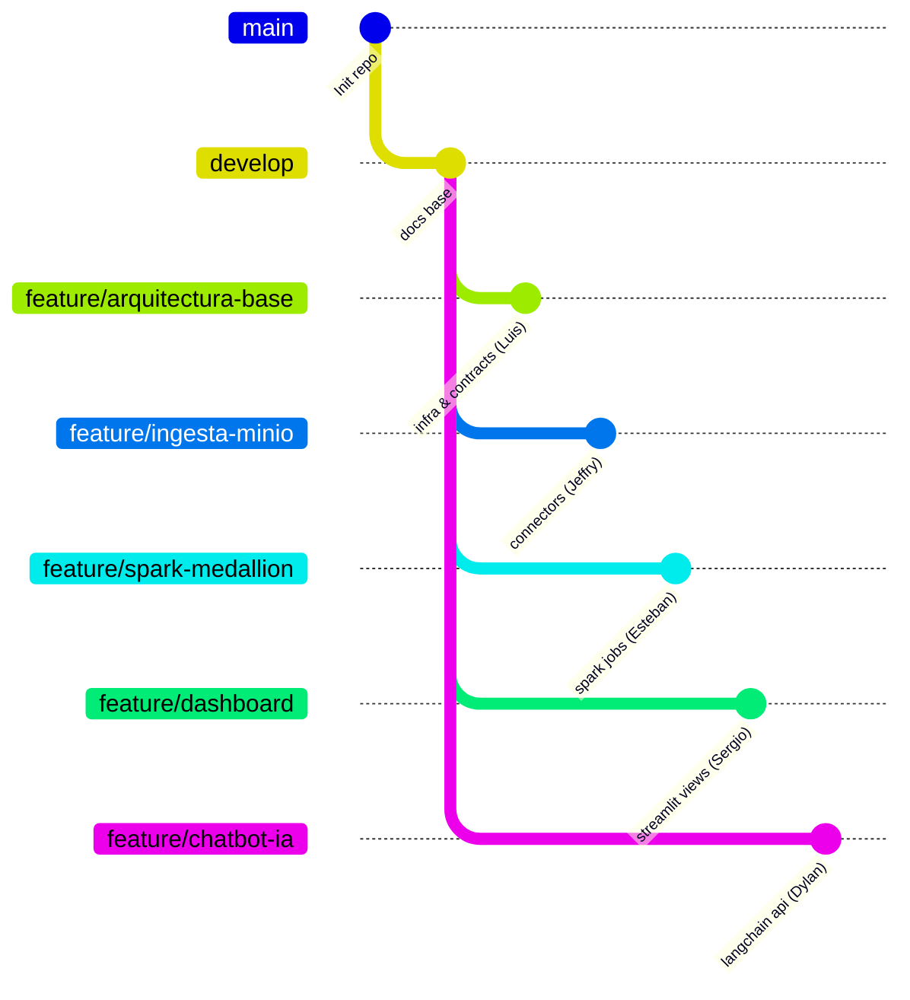

# GUÍA DE DESARROLLO, ONBOARDING Y CONVENCIONES GIT

> **Proyecto:** Plataforma Extensible de Datos (Medallion Platform)  
> **Autor:** Luis Gómez (Sublíder & Arquitectura)  
> **Fecha:** 19 de octubre de 2026  
> **Versión:** 1.0.0  

---

## 1. Bienvenida y Objetivo del Entorno Base

Esta guía permite a cada integrante del equipo clonar el repositorio, levantar los servicios base en menos de 5 minutos y comenzar a desarrollar su módulo correspondiente sin lidiar con configuraciones manuales o dependencias rotas.

---

## 2. Requisitos Previos del Sistema (Linux / Ubuntu)

Antes de comenzar, asegúrate de contar con:
- **Docker Engine:** Versión 24.0 o superior (`docker --version`).
- **Docker Compose:** Versión v2.20 o superior (`docker compose version`).
- **Python:** 3.10, 3.11 o 3.12 (`python3 --version`).
- **Memoria RAM disponible:** Mínimo 4 GiB libres recomendados.

---

## 3. Configuración Inicial del Entorno (Paso a Paso)

### Paso 1: Clonar el Repositorio
```bash
git clone https://github.com/dypok/Pipeline-analitica.git
cd Pipeline-analitica
```

### Paso 2: Crear el Entorno Virtual de Python e Instalar Dependencias
```bash
python3 -m venv .venv
source .venv/bin/activate
pip install --upgrade pip
pip install -r requirements.txt
```

### Paso 3: Configurar Variables de Entorno
```bash
# Copia el archivo de ejemplo para generar tu configuración local
cp .env.example .env

# Nota: El archivo .env ya viene preconfigurado con puertos libres (PostgreSQL en 5433, MinIO en 9000/9001)
```

---

## 4. Gestión de Infraestructura con Docker Compose

### 4.1 Iniciar Todos los Servicios en Segundo Plano
```bash
docker compose up -d
```

### 4.2 Verificar el Estado de Salud de los Contenedores
```bash
docker compose ps
# O utiliza nuestro script de diagnóstico automatizado:
./scripts/check_health.sh
```

### 4.3 Endpoints y Accesos Locales
| Servicio | URL / Host | Puerto | Credenciales |
| :--- | :--- | :--- | :--- |
| **Airflow Web UI** | [http://localhost:8080](http://localhost:8080) | `8080` | `admin` / `admin` |
| **MinIO Console** | [http://localhost:9001](http://localhost:9001) | `9001` | `minioadmin` / `miniopassword123` |
| **MinIO API S3** | [http://localhost:9000](http://localhost:9000) | `9000` | `minioadmin` / `miniopassword123` |
| **Spark Master UI** | [http://localhost:8081](http://localhost:8081) | `8081` | N/A |
| **PostgreSQL Analítico** | `localhost` | `5433` | `medallion_user` / `medallion_secret` (BD: `analytics_db`) |

### 4.4 Detener la Infraestructura
```bash
# Detener contenedores preservando datos de volúmenes:
docker compose down

# Si deseas reiniciar limpiando volúmenes (precaución: borra datos locales):
docker compose down -v
```

---

## 5. Ejecución del Flujo de Prueba y Verificación

### 5.1 Ejecución Local del Pipeline Medallion E2E
Para comprobar que MinIO, PostgreSQL y las transformaciones de datos funcionan correctamente de extremo a extremo:
```bash
./scripts/run_pipeline_local.sh
```
*Salida esperada:*
- Generación de órdenes sintéticas.
- Carga a `s3://landing/`.
- Promoción con metadatos a `s3://bronze/`.
- Transformación y segregación a `s3://silver/` (Parquet) y `s3://quarantine/`.
- Agregación diaria a `s3://gold/` y sincronización en PostgreSQL (`analytics.daily_sales_kpis`).

### 5.2 Ejecución de la Suite de Pruebas Automatizadas
```bash
pytest -v
```

---

## 6. Estrategia de Ramas Git y Flujo de Trabajo del Equipo

Seguimos una versión adaptada y disciplinada de **Git Flow**:



### 6.1 Asignación de Ramas de Trabajo:
| Integrante | Rol | Rama Asignada |
| :--- | :--- | :--- |
| **Luis Gómez** | Sublíder & Arquitectura | `feature/arquitectura-base` |
| **Jeffry** | Ingesta y Conectores | `feature/ingesta-minio` |
| **Esteban Padilla** | Procesamiento Spark | `feature/spark-medallion` |
| **Héctor** | Orquestación Airflow | `feature/airflow-orquestacion` |
| **Sebastián Ortiz** | Calidad & Gobernanza | `feature/calidad-gobierno` |
| **Sergio** | Dashboards Analíticos | `feature/dashboard` |
| **Dylan Gamero** | Líder & Chatbot IA | `feature/chatbot-ia` |

### 6.2 Instrucciones para Comenzar a Trabajar en tu Rama:
1. **Actualizar `develop`:**
   ```bash
   git checkout develop
   git pull origin develop
   ```
2. **Crear tu rama de feature:**
   ```bash
   # Ejemplo para Esteban Padilla:
   git checkout -b feature/spark-medallion develop
   ```
3. **Desarrollar y hacer commits atómicos:**
   ```bash
   git add src/silver/
   git commit -m "feat(silver): implement strict schema and deduplication"
   ```
4. **Sincronizar cambios recientes de `develop` antes de entregar:**
   ```bash
   git fetch origin
   git merge origin/develop
   pytest -v  # Verificar que las pruebas sigan pasando
   ```
5. **Crear Pull Request en GitHub:**
   - Origen: tu rama (`feature/...`)
   - Destino: **`develop`**
   - Completa la plantilla de PR (`.github/pull_request_template.md`).

---

## 7. Diagnóstico y Resolución de Problemas Comunes

### Error: Puerto 5432 ya está en uso
- **Causa:** Tienes una instancia local de PostgreSQL corriendo en tu sistema anfitrión.
- **Solución implementada:** Nuestro `docker-compose.yml` mapea PostgreSQL al puerto **`5433`** en el host. Asegúrate de conectar tus herramientas locales (DBeaver, psql) a `localhost:5433`.

### Error: Docker no puede descargar una imagen
- **Solución:** Revisa tu conexión a internet o ejecuta `./scripts/check_health.sh` para diagnosticar conectividad y recursos.
