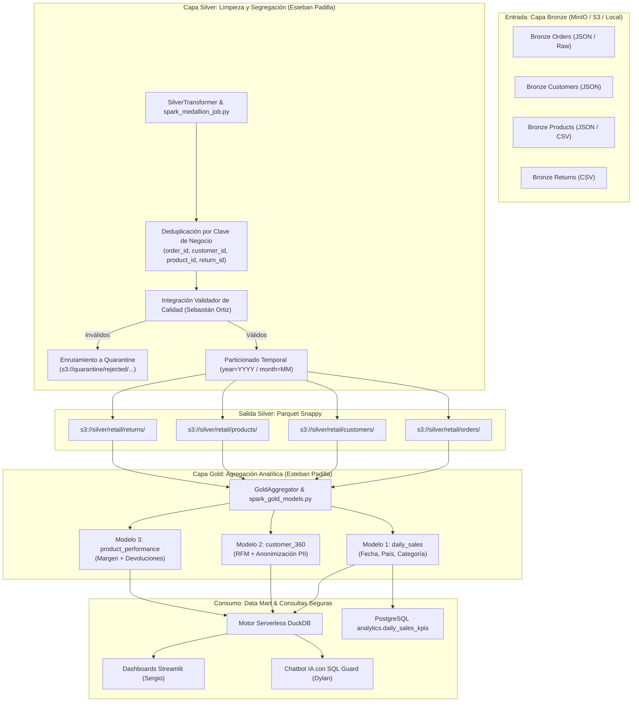

# DOCUMENTACIÓN TÉCNICA: PROCESAMIENTO SPARK, CAPA SILVER Y CAPA GOLD

> **Proyecto:** Plataforma Extensible de Datos (Arquitectura Medallion)  
> **Responsable:** Esteban Padilla (Ingeniero de Datos — Procesamiento Distribuido)  
> **Historias de Usuario:** US-06 (Bronze a Silver) y US-07 (Modelos Gold)  
> **Rama Oficial:** `feature/spark-medallion`  
> **Fecha:** 19 de octubre de 2026  
> **Versión:** 1.0.0  

---

## 1. Resumen de Responsabilidades

De acuerdo con el Capítulo 15.5 y los contratos de integración de la plataforma, el módulo de **Procesamiento Distribuido (Spark, Silver y Gold)** es responsable de:
1. **Transformación y Calidad Bronze -> Silver (US-06):**
   - Ingestar datasets en formato Bronze (`orders`, `customers`, `products`, `returns`).
   - Normalizar textos, cadenas y formatos de fecha (`YYYY-MM-DD`).
   - Aplicar tipado estricto (enteros, flotantes de precisión doble, timestamps).
   - Ejecutar deduplicación determinista basada en clave primaria / de negocio, preservando el registro con la marca de tiempo más reciente (`_metadata.ingested_at`).
   - Detectar violaciones de reglas críticas (montos negativos, estados desconocidos, claves foráneas nulas) y enrutar anomalías a la zona **Quarantine** (`s3://quarantine/`).
   - Persistir en MinIO Silver en formato **Parquet Snappy**, particionado por `year` y `month`.
2. **Modelado Analítico Multidimensional en Capa Gold (US-07):**
   - Construir datasets optimizados para consulta interactiva en DuckDB, dashboards (Sergio) y Chatbot IA (Dylan Gamero).
   - Generar los tres modelos de negocio oficiales:
     - `daily_sales` (Grano: `order_date`, `shipping_country`, `category`).
     - `customer_360` (Grano: `customer_id` con LTV, RFM y anonimización PII).
     - `product_performance` (Grano: `product_id` con costos, margen y tasas de retorno).
   - Garantizar la consistencia matemática absoluta entre Silver y Gold (prueba T07.1 / P06 con diferencia `0.00`).
   - Garantizar idempotencia (prueba T07.2 / P05) ante re-ejecuciones sobre las mismas particiones.

---

## 2. Arquitectura de Procesamiento Dual (Spark Distribuido + Engine Local)

Para habilitar tanto la ejecución en clústeres distribuidos (Apache Spark 3.5.1 en Docker o Kubernetes) como la ejecución liviana en entornos de desarrollo local, el módulo implementa dos capas acoplables:



---

## 3. Especificación de Transformaciones Silver (US-06)

### 3.1 Normalización y Deduplicación
- **Órdenes (`orders`):**
  - Clave de unicidad: `["order_id", "item_id"]` si existe granularidad de items; de lo contrario `["order_id"]`.
  - Criterio de retención: último registro ingerido (`keep='last'` o `Window.partitionBy().orderBy(desc('ingested_at'))`).
  - Limpieza de cadenas: `.str.strip()` para eliminar espacios invisibles.
  - Formato de fecha: `YYYY-MM-DD` convertido a objeto de fecha nativo.
  - Columnas de partición calculadas: `year` (int32) y `month` (int32).
- **Clientes (`customers`):**
  - Clave de unicidad: `customer_id`.
  - Normalización: `country` a mayúsculas de 2 letras, `email` a minúsculas, `first_name` y `last_name` a formato título.
- **Productos (`products`):**
  - Clave de unicidad: `product_id`.
  - Tipado de precios: `unit_price` y `cost_price` forzados a `float64` con validación `> 0`.
- **Devoluciones (`returns`):**
  - Clave de unicidad: `return_id`.
  - Tipado: `refund_amount` forzado a `float64 >= 0.0`.

### 3.2 Reglas de Quarantine y Enriquecimiento de Anomalías
Todo registro rechazado por el motor de validación se separa inmediatamente antes de escribir en Silver, enriqueciéndose con:
```json
{
  "rejected_at": "2026-10-19T17:55:00.000000Z",
  "entity_type": "orders",
  "error_code": "ERR_NEGATIVE_AMOUNT",
  "quarantine_reason": "Monto inválido (debe ser > 0): -50.0",
  "raw_record": {
    "order_id": "ORD-000011",
    "customer_id": "CUST-0002",
    "total_amount": -50.0,
    "status": "COMPLETED"
  }
}
```

---

## 4. Especificación de Modelos Analíticos Gold (US-07)

### 4.1 Modelo `daily_sales`
- **Grano:** `(order_date, shipping_country, category)`.
- **Métricas:**
  - `total_revenue`: Suma estricta de `total_amount` únicamente para órdenes con `status == 'COMPLETED'`.
  - `orders_count`: Conteo único de `order_id` completadas.
  - `units_sold`: Suma de `quantity` completadas.
  - `avg_ticket`: `round(total_revenue / orders_count, 2)`.
  - `returns_count`: Conteo de devoluciones para esa fecha, país y categoría.
  - `refunded_amount`: Monto total reembolsado.
- **Cuadre matemático (T07.1 / P06):**
  $$\sum \text{daily\_sales.total\_revenue} = \sum_{\text{status} = \text{'COMPLETED'}} \text{orders.total\_amount}$$
  La diferencia debe ser exactamente `0.00`.

### 4.2 Modelo `customer_360`
- **Grano:** `customer_id`.
- **Métricas:**
  - `first_purchase_date` y `last_purchase_date`.
  - `total_orders`: Conteo de compras completadas.
  - `lifetime_value` (LTV): Facturación acumulada histórica.
  - `avg_order_value`: Ticket promedio del cliente.
  - `favorite_category`: Categoría con mayor volumen de unidades adquiridas.
  - `rfm_segment`: Segmentación según Recencia, Frecuencia y Valor Monetario:
    - *Champions* ($\text{Recencia} \le 30 \text{ días}, \text{Frecuencia} \ge 5$).
    - *Loyal Customers* ($\text{Recencia} \le 60 \text{ días}, \text{Frecuencia} \ge 3$).
    - *Potential Loyalist* ($\text{Recencia} \le 90 \text{ días}, \text{LTV} \ge \$500$).
    - *At Risk* ($\text{Recencia} > 120 \text{ días}$).
    - *Occasional / New* (Resto de usuarios).
- **Protección de Datos Personales (PII Minimization):**
  - Conforme al Capítulo 12.3 del documento técnico, la capa analítica Gold no expone correos ni teléfonos en texto claro.
  - `email` se enmascara mediante Hashing unidireccional SHA-256 (`email_hash`).
  - `phone` se enmascara preservando únicamente los últimos 4 dígitos (`phone_masked`, ej. `+***-***-4567`).

### 4.3 Modelo `product_performance`
- **Grano:** `product_id`.
- **Métricas:**
  - `units_sold` y `gross_revenue`.
  - `orders_count`: Presencia en pedidos únicos.
  - `cost_price` y `total_cost`: `units_sold * cost_price`.
  - `margin`: `gross_revenue - total_cost`.
  - `returns_count` y `return_rate`: $\frac{\text{returns\_count}}{\text{units\_sold}}$.
  - `performance_tier`: Clasificación de rentabilidad y retorno:
    - *Top Performer* ($\text{Margen} > 500 \text{ y tasa de devolución} \le 5\%$).
    - *Underperforming* ($\text{Margen} < 0 \text{ o tasa de devolución} > 15\%$).
    - *Standard Performer* (Rango medio equilibrado).

---

## 5. Instrucciones de Ejecución

### 5.1 Ejecución mediante Scripts Modulares (`processing/`)
```bash
# Limpieza de órdenes Silver
python processing/silver/clean_orders.py --input-file data/mock/raw/orders.csv

# Limpieza de clientes Silver
python processing/silver/clean_customers.py --input-file data/mock/raw/customers.json

# Construcción de Gold daily_sales
python processing/gold/build_daily_sales.py --orders-silver data/mock/raw/orders.csv

# Construcción de Gold customer_360
python processing/gold/build_customer_360.py --orders-silver data/mock/raw/orders.csv --customers-silver data/mock/raw/customers.json

# Construcción de Gold product_performance
python processing/gold/build_product_performance.py --orders-silver data/mock/raw/orders.csv --products-silver data/mock/raw/products.csv
```

### 5.2 Ejecución con Apache Spark (PySpark)
```bash
# Ejecutar job distribuido de órdenes Silver
python -m src.silver.spark_medallion_job s3a://bronze/orders.json s3a://silver/retail/orders s3a://quarantine/rejected/orders

# Ejecutar jobs distribuidos de modelos Gold
python -m src.gold.spark_gold_models s3a://silver/retail/orders s3a://gold/analytics
```

### 5.3 Ejecución de Pruebas Unitarias y de Integración
```bash
# Ejecutar toda la suite de pruebas
pytest -v

# Ejecutar exclusivamente las pruebas de transformaciones de Esteban Padilla
pytest tests/test_transformations.py tests/unit/test_spark_silver_gold.py -v
```

---

## 6. Resultados de Verificación y Cuadre

| ID | Prueba | Criterio de Éxito | Resultado |
| :--- | :--- | :--- | :--- |
| **T06.1** | Deduplicación Silver | Elimina duplicados conservando el último registro | **APROBADO** |
| **T06.2** | Tipado Estricto | Casteo seguro sin desbordamiento ni nulos | **APROBADO** |
| **P04** | Enrutamiento Quarantine | Registros anómalos aislados con `error_code` y motivo | **APROBADO** |
| **P06 / T07.1**| Cuadre Matemático | $\Delta(\text{Silver Completed}, \text{Gold Revenue}) = 0.00$ | **APROBADO (0.00)** |
| **P05 / T07.2**| Idempotencia | Re-ejecución sobre la misma partición produce resultados idénticos | **APROBADO** |
| **PII-01** | Protección de Datos | `email` y `phone` en texto claro no existen en `customer_360` | **APROBADO (SHA-256)** |
