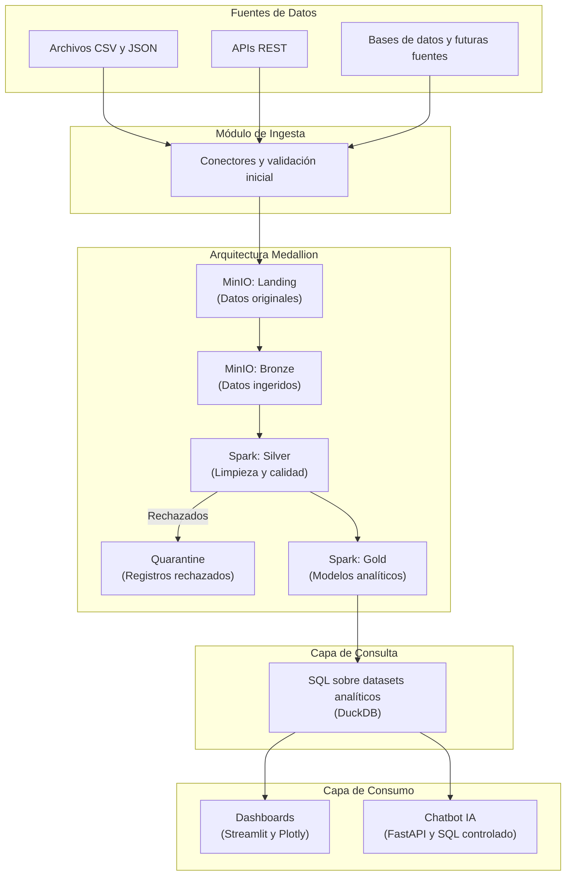
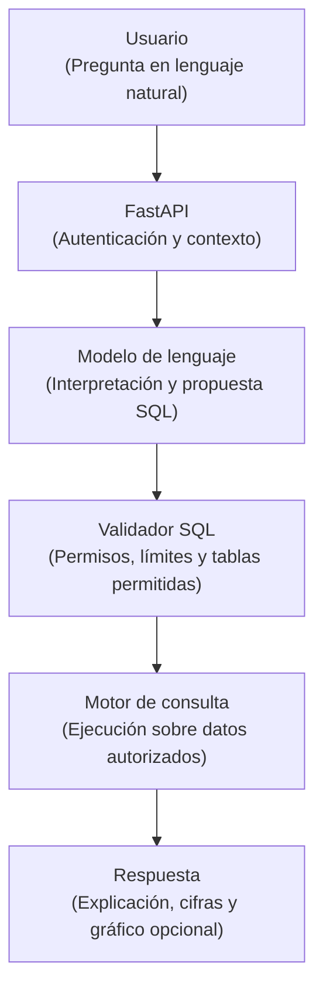
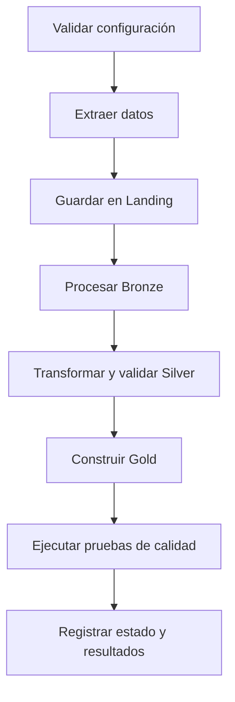
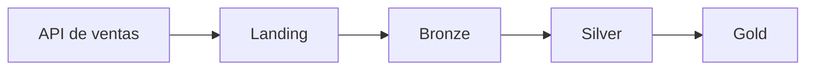

# DOCUMENTO TÉCNICO: ARQUITECTURA MEDALLION
## Plataforma extensible de integración, procesamiento, gobernanza y analítica de datos
### *Una plataforma para integrar, transformar, visualizar y consultar datos mediante inteligencia artificial*

> Arquitectura modular basada en MinIO, Apache Spark, Apache Airflow, OpenMetadata y Apache Atlas.
> 
> **Versión:** 2.0  
> **Fecha:** 19 de octubre de 2026  
> **Documento de diseño y planificación técnica**

---

## Control documental

| Campo | Descripción |
| :--- | :--- |
| **Nombre del proyecto** | Plataforma Extensible de Datos |
| **Versión** | 2.0 |
| **Fecha** | 19 de octubre de 2026 |
| **Tipo de documento** | Arquitectura y plan de implementación |
| **Equipo** | Siete integrantes |
| **Enfoque** | Ingeniería de datos, analítica y gobernanza |
| **Estado** | Propuesta técnica para implementación incremental |

---

## Resumen ejecutivo

El proyecto propone diseñar e implementar una plataforma modular de datos que permita integrar información de distintas fuentes, almacenarla de forma organizada, procesarla con criterios de calidad y convertirla en información útil para la toma de decisiones.

La solución admitirá archivos CSV y JSON, así como el consumo de APIs REST. Los datos se organizarán mediante una arquitectura Medallion compuesta por las zonas **Landing**, **Bronze**, **Silver**, **Gold** y **Quarantine**. **MinIO** funcionará como almacenamiento de objetos y **Apache Spark** como motor principal de transformación y procesamiento.

La plataforma ofrecerá dos mecanismos principales de consumo: **dashboards interactivos** para explorar indicadores y tendencias, y un **chatbot de analítica** que responderá preguntas en lenguaje natural mediante consultas controladas sobre los datos disponibles. Ambos utilizarán definiciones compartidas de métricas para mantener la consistencia de los resultados.

**Apache Airflow** coordinará las ejecuciones y sus dependencias. **OpenMetadata** apoyará la documentación y el linaje, mientras que **Apache Atlas** se utilizará para clasificación y gobernanza. La implementación será incremental: primero se consolidará un flujo de extremo a extremo y después se ampliarán las fuentes, la automatización y las capacidades de gobierno.

> [!IMPORTANT]
> **Principio central:** Los dashboards y el chatbot deben utilizar la misma capa de consulta y las mismas definiciones de métricas. Las respuestas numéricas del chatbot deberán estar respaldadas por resultados reales, no por información inventada por el modelo.

---

## Índice general

- [Control documental](#control-documental)
- [Resumen ejecutivo](#resumen-ejecutivo)
- [1. Introducción y planteamiento del problema](#1-introducción-y-planteamiento-del-problema)
  - [1.1. Contexto](#11-contexto)
  - [1.2. Problema que se busca resolver](#12-problema-que-se-busca-resolver)
  - [1.3. Objetivo general](#13-objetivo-general)
  - [1.4. Objetivos específicos](#14-objetivos-específicos)
- [2. Alcance y requisitos](#2-alcance-y-requisitos)
  - [2.1. Funcionalidades incluidas](#21-funcionalidades-incluidas)
    - [2.1.1. Ingesta de datos](#211-ingesta-de-datos)
    - [2.1.2. Procesamiento](#212-procesamiento)
    - [2.1.3. Analítica y consumo](#213-analítica-y-consumo)
    - [2.1.4. Gobernanza y operación](#214-gobernanza-y-operación)
  - [2.2. Alcance del MVP](#22-alcance-del-mvp)
  - [2.3. Fuera del alcance inicial](#23-fuera-del-alcance-inicial)
- [3. Arquitectura general de la solución](#3-arquitectura-general-de-la-solución)
  - [3.1. Principios de diseño](#31-principios-de-diseño)
  - [3.2. Diagrama de arquitectura](#32-diagrama-de-arquitectura)
  - [3.3. Servicios transversales](#33-servicios-transversales)
- [4. Fuentes de información y conectores](#4-fuentes-de-información-y-conectores)
  - [4.1. Tipos de fuentes](#41-tipos-de-fuentes)
  - [4.2. Contrato común de los conectores](#42-contrato-común-de-los-conectores)
  - [4.3. Metadatos de ingesta](#43-metadatos-de-ingesta)
  - [4.4. Seguridad de las fuentes](#44-seguridad-de-las-fuentes)
- [5. Arquitectura Medallion](#5-arquitectura-medallion)
  - [5.1. Landing: recepción original](#51-landing-recepción-original)
  - [5.2. Bronze: datos ingeridos](#52-bronze-datos-ingeridos)
  - [5.3. Silver: datos limpios y validados](#53-silver-datos-limpios-y-validados)
  - [5.4. Gold: datos analíticos](#54-gold-datos-analíticos)
    - [5.4.1. Modelo daily_sales](#541-modelo-daily_sales)
    - [5.4.2. Modelo customer_360](#542-modelo-customer_360)
    - [5.4.3. Modelo product_performance](#543-modelo-product_performance)
  - [5.5. Quarantine: registros rechazados](#55-quarantine-registros-rechazados)
- [6. Calidad, reproducibilidad e idempotencia](#6-calidad-reproducibilidad-e-idempotencia)
  - [6.1. Controles de calidad](#61-controles-de-calidad)
  - [6.2. Idempotencia](#62-idempotencia)
  - [6.3. Métricas operativas](#63-métricas-operativas)
- [7. Capa de consulta](#7-capa-de-consulta)
  - [7.1. Objetivo](#71-objetivo)
  - [7.2. Tecnología inicial](#72-tecnología-inicial)
  - [7.3. Reglas de acceso](#73-reglas-de-acceso)
- [8. Dashboards interactivos](#8-dashboards-interactivos)
  - [8.1. Objetivo](#81-objetivo)
  - [8.2. Tecnologías propuestas](#82-tecnologías-propuestas)
  - [8.3. Funcionalidades](#83-funcionalidades)
  - [8.4. Dashboards dinámicos](#84-dashboards-dinámicos)
- [9. Chatbot de analítica con inteligencia artificial](#9-chatbot-de-analítica-con-inteligencia-artificial)
  - [9.1. Objetivo](#91-objetivo)
  - [9.2. Arquitectura del chatbot](#92-arquitectura-del-chatbot)
  - [9.3. Ejemplos de preguntas](#93-ejemplos-de-preguntas)
    - [9.3.1. Dominio de ventas](#931-dominio-de-ventas)
    - [9.3.2. Otros dominios](#932-otros-dominios)
  - [9.4. Funcionamiento](#94-funcionamiento)
  - [9.5. Seguridad y confiabilidad](#95-seguridad-y-confiabilidad)
  - [9.6. Contexto y comparación entre datasets](#96-contexto-y-comparación-entre-datasets)
- [10. Orquestación con Apache Airflow](#10-orquestación-con-apache-airflow)
  - [10.1. Responsabilidad](#101-responsabilidad)
  - [10.2. Flujo general del DAG](#102-flujo-general-del-dag)
  - [10.3. Funciones operativas](#103-funciones-operativas)
- [11. Linaje y metadatos con OpenMetadata](#11-linaje-y-metadatos-con-openmetadata)
  - [11.1. Objetivo](#111-objetivo)
  - [11.2. Responsabilidades](#112-responsabilidades)
  - [11.3. Ejemplo de linaje](#113-ejemplo-de-linaje)
- [12. Gobernanza y clasificación con Apache Atlas](#12-gobernanza-y-clasificación-con-apache-atlas)
  - [12.1. Objetivo](#121-objetivo)
  - [12.2. Responsabilidades](#122-responsabilidades)
  - [12.3. Ejemplo de clasificación](#123-ejemplo-de-clasificación)
  - [12.4. Diferencia entre gobernanza y seguridad efectiva](#124-diferencia-entre-gobernanza-y-seguridad-efectiva)
- [13. Infraestructura y despliegue](#13-infraestructura-y-despliegue)
  - [13.1. Tecnologías propuestas](#131-tecnologías-propuestas)
  - [13.2. Configuración y secretos](#132-configuración-y-secretos)
  - [13.3. Gestión de recursos](#133-gestión-de-recursos)
- [14. Estructura propuesta del repositorio](#14-estructura-propuesta-del-repositorio)
- [15. Distribución del trabajo](#15-distribución-del-trabajo)
  - [15.1. Dylan Gamero: líder y chatbot de inteligencia artificial](#151-dylan-gamero-líder-y-chatbot-de-inteligencia-artificial)
  - [15.2. Luis Gómez: sublíder y arquitectura](#152-luis-gómez-sublíder-y-arquitectura)
  - [15.3. Jeffry: ingesta y arquitectura de conectores](#153-jeffry-ingesta-y-arquitectura-de-conectores)
  - [15.4. Sergio: dashboards y capa de presentación](#154-sergio-dashboards-y-capa-de-presentación)
  - [15.5. Esteban Padilla: Spark, Silver y Gold](#155-esteban-padilla-spark-silver-y-gold)
  - [15.6. Héctor: Airflow y automatización](#156-héctor-airflow-y-automatización)
  - [15.7. Sebastián Ortiz: calidad y gobierno de datos](#157-sebastián-ortiz-calidad-y-gobierno-de-datos)
  - [15.8. Responsabilidades compartidas](#158-responsabilidades-compartidas)
  - [15.9. Criterios de seguimiento](#159-criterios-de-seguimiento)
- [16. Plan de implementación](#16-plan-de-implementación)
  - [16.1. Fase 1: definición y contratos](#161-fase-1-definición-y-contratos)
  - [16.2. Fase 2: primer flujo de extremo a extremo](#162-fase-2-primer-flujo-de-extremo-a-extremo)
  - [16.3. Fase 3: extensión de fuentes y calidad](#163-fase-3-extensión-de-fuentes-y-calidad)
  - [16.4. Fase 4: dashboards y chatbot](#164-fase-4-dashboards-y-chatbot)
  - [16.5. Fase 5: orquestación y gobernanza](#165-fase-5-orquestación-y-gobernanza)
  - [16.6. Fase 6: pruebas y presentación](#166-fase-6-pruebas-y-presentación)
- [17. Pruebas de aceptación](#17-pruebas-de-aceptación)
- [18. Riesgos y estrategias de mitigación](#18-riesgos-y-estrategias-de-mitigación)
- [19. Priorización del alcance](#19-priorización-del-alcance)
  - [19.1. Requisitos imprescindibles](#191-requisitos-imprescindibles)
  - [19.2. Requisitos de gobernanza](#192-requisitos-de-gobernanza)
  - [19.3. Extensiones futuras](#193-extensiones-futuras)
- [20. Conclusiones](#20-conclusiones)
- [Apéndice A. Acuerdos técnicos antes de comenzar](#apéndice-a-acuerdos-técnicos-antes-de-comenzar)
- [Apéndice B. Referencias técnicas oficiales](#apéndice-b-referencias-técnicas-oficiales)

---

## 1. Introducción y planteamiento del problema

### 1.1 Contexto
Las organizaciones reciben información desde diferentes sistemas, archivos y servicios externos. Sin una arquitectura organizada, la integración de estos datos puede generar duplicados, inconsistencias, errores de formato, pérdida de trazabilidad y dificultades para obtener indicadores confiables.

Además, el análisis de información suele depender de consultas manuales, herramientas aisladas o conocimientos técnicos especializados. Esto dificulta que los usuarios comprendan los datos y respondan preguntas de negocio con rapidez.

Por ello, se propone una plataforma centralizada que organice el ciclo de vida de los datos, desde su recepción hasta su consulta analítica.

### 1.2 Problema que se busca resolver
La plataforma debe resolver cinco necesidades principales:
1. Integrar información de fuentes y formatos diferentes.
2. Conservar la procedencia y asegurar la reproducibilidad de los procesos.
3. Detectar errores y transformar datos en estructuras confiables.
4. Facilitar la exploración mediante dashboards y consultas en lenguaje natural.
5. Gestionar metadatos, linaje, clasificación y controles de acceso.

### 1.3 Objetivo general
Diseñar e implementar una plataforma extensible de ingeniería y analítica de datos basada en arquitectura Medallion, capaz de integrar múltiples fuentes de información, procesarlas de manera automatizada, gestionar su calidad y gobernanza, y facilitar su exploración mediante dashboards interactivos y un chatbot de analítica con inteligencia artificial.

### 1.4 Objetivos específicos
- Implementar conectores reutilizables para CSV, JSON y APIs REST.
- Diseñar una arquitectura preparada para incorporar bases de datos y nuevas fuentes.
- Implementar las capas Landing, Bronze, Silver, Gold y Quarantine con MinIO y Apache Spark.
- Definir reglas de calidad, validación y tratamiento de errores.
- Coordinar las ejecuciones mediante Apache Airflow.
- Desarrollar dashboards adaptables a los datasets disponibles.
- Implementar un chatbot que consulte datos reales mediante consultas SQL controladas.
- Documentar el linaje utilizando OpenMetadata.
- Gestionar clasificaciones y gobernanza mediante Apache Atlas.
- Validar idempotencia, seguridad, reproducibilidad y resultados.

---

## 2. Alcance y requisitos

### 2.1 Funcionalidades incluidas

#### 2.1.1 Ingesta de datos
- Carga manual de archivos CSV y JSON.
- Consumo de APIs REST.
- Registro de fuente, fecha, estado e identificador de ejecución.
- Validación inicial de formatos y estructuras.
- Manejo de errores de conexión, autenticación, paginación y límites de solicitudes.
- Diseño modular para añadir conectores.

#### 2.1.2 Procesamiento
- Conservación de datos originales.
- Conversión a formatos analíticos, principalmente Parquet.
- Normalización y validación de tipos.
- Detección y tratamiento de duplicados.
- Aplicación de reglas de calidad.
- Gestión de registros rechazados mediante Quarantine.
- Construcción de datasets analíticos reutilizables.

#### 2.1.3 Analítica y consumo
- Dashboards interactivos con filtros.
- Visualización de indicadores y tendencias.
- Selección del dataset que se desea analizar.
- Chatbot de preguntas en lenguaje natural.
- Respuestas sustentadas en consultas y resultados reales.
- Visualización de tablas y gráficos asociados a las respuestas.
- Explicación de limitaciones cuando no existan datos suficientes.

#### 2.1.4 Gobernanza y operación
- Orquestación y seguimiento de procesos.
- Registro de metadatos y visualización del linaje.
- Clasificación de información sensible.
- Control de acceso en las capas correspondientes.
- Pruebas técnicas y documentación.

### 2.2 Alcance del MVP
El producto mínimo viable priorizará un flujo completo y verificable antes de ampliar el número de conectores y funcionalidades.

#### Cuadro 2.1: Alcance inicial
| Componente | Alcance del MVP |
| :--- | :--- |
| **Fuentes** | CSV, JSON y al menos una API REST |
| **Almacenamiento** | MinIO y archivos Parquet |
| **Procesamiento** | Apache Spark y arquitectura Medallion |
| **Orquestación** | Apache Airflow |
| **Consulta** | DuckDB sobre datos Gold |
| **Dashboards** | Streamlit y Plotly |
| **Chatbot** | Modelo de lenguaje y consultas SQL controladas |
| **Linaje** | OpenMetadata |
| **Gobernanza** | Apache Atlas |

### 2.3 Fuera del alcance inicial
- Soporte automático para absolutamente todas las APIs y sistemas.
- Entrenamiento de un modelo de lenguaje desde cero.
- Procesamiento streaming con Kafka.
- Despliegue obligatorio en Kubernetes.
- Alta disponibilidad de nivel empresarial.
- Integración de todos los motores de consulta existentes.

Estas funcionalidades podrán incorporarse en versiones posteriores si el tiempo, los recursos y los requisitos lo permiten.

---

## 3. Arquitectura general de la solución

### 3.1 Principios de diseño
La arquitectura seguirá los siguientes principios:
- **Modularidad:** cada componente tendrá una responsabilidad definida.
- **Extensibilidad:** las nuevas fuentes se incorporarán mediante conectores.
- **Reproducibilidad:** los procesos podrán ejecutarse nuevamente con entradas y configuraciones identificables.
- **Trazabilidad:** se conservará la procedencia de los datos.
- **Calidad:** los datos serán validados antes de su publicación analítica.
- **Seguridad:** se aplicarán controles de acceso y protección de credenciales.
- **Consistencia:** dashboards y chatbot compartirán las mismas definiciones de métricas.

### 3.2 Diagrama de arquitectura


*Figura 3.1: Arquitectura lógica de la plataforma de datos.*

### 3.3 Servicios transversales
Los servicios de operación y gobernanza estarán conectados con los componentes que correspondan.

#### Cuadro 3.1: Responsabilidades transversales
| Componente | Responsabilidad |
| :--- | :--- |
| **Apache Airflow** | Coordinar dependencias, ejecuciones, reintentos y estados de los procesos. |
| **OpenMetadata** | Documentar datasets, esquemas, propietarios y linaje. |
| **Apache Atlas** | Gestionar clasificaciones, metadatos de gobernanza y políticas compatibles. |
| **Docker** | Facilitar el despliegue reproducible de los servicios. |
| **Git** | Gestionar versiones y colaboración entre integrantes. |

---

## 4. Fuentes de información y conectores

### 4.1 Tipos de fuentes

#### Cuadro 4.1: Fuentes y mecanismos de incorporación
| Fuente | Formato | Mecanismo |
| :--- | :--- | :--- |
| **Archivos CSV** | Texto delimitado | Carga desde la aplicación y validación de encabezados. |
| **Archivos JSON** | JSON | Lectura estructurada y validación de esquema. |
| **APIs REST** | HTTP/HTTPS | Solicitudes, autenticación, paginación y manejo de errores. |
| **PostgreSQL** | SQL | Conector de base de datos, previsto como extensión. |
| **MySQL** | SQL | Conector de base de datos, previsto como extensión. |
| **Nuevas fuentes** | Según el sistema | Adaptador compatible con el contrato común de ingesta. |

### 4.2 Contrato común de los conectores
Cada conector deberá implementar operaciones equivalentes a:
1. Configurar la fuente.
2. Validar la conexión o el archivo.
3. Obtener los datos.
4. Validar la estructura inicial.
5. Registrar los metadatos de la ejecución.
6. Guardar la información en Landing.
7. Informar el estado y los errores.

Las particularidades de cada API o formato se mantendrán dentro de su adaptador. El procesamiento posterior no deberá depender directamente de una fuente específica.

### 4.3 Metadatos de ingesta
Se propone registrar, como mínimo:

#### Cuadro 4.2: Metadatos de control
| Campo | Descripción |
| :--- | :--- |
| `source_id` | Identificador de la fuente. |
| `source_type` | Tipo de fuente: CSV, JSON, API, etc. |
| `dataset_name` | Nombre lógico del dataset. |
| `ingestion_id` | Identificador único de la ejecución. |
| `ingested_at` | Fecha y hora de ingesta en UTC. |
| `schema_version` | Versión del esquema utilizado. |
| `status` | Estado final de la ejecución. |
| `record_count` | Cantidad de registros, cuando se conozca. |

Estos campos podrán mantenerse en manifiestos o tablas de control. No es obligatorio incorporarlos todos a cada registro de negocio.

### 4.4 Seguridad de las fuentes
Las credenciales deberán almacenarse en variables de entorno o mecanismos seguros de secretos. No se incluirán tokens, contraseñas ni claves privadas en el código, los archivos de datos o los logs.

Las URLs proporcionadas por usuarios deberán validarse para evitar que el sistema acceda a servicios internos o direcciones no autorizadas. También deberán configurarse límites de tiempo, reintentos y tamaño de respuesta.

---

## 5. Arquitectura Medallion

### 5.1 Landing: recepción original
Landing conservará los archivos o respuestas originales recibidos desde las fuentes.

Sus responsabilidades serán:
- Preservar el contenido recibido.
- Registrar procedencia y fecha de recepción.
- Asociar los datos con su ejecución de ingesta.
- Evitar transformaciones destructivas.
- Permitir la reproducción de procesos.

### 5.2 Bronze: datos ingeridos
Bronze almacenará los datos recibidos en una estructura preparada para el procesamiento analítico, preservando su significado y procedencia.

Las operaciones incluirán:
- Lectura desde Landing.
- Conversión a Parquet cuando corresponda.
- Normalización técnica básica.
- Registro de metadatos de ingesta.
- Conservación de referencias al origen.

### 5.3 Silver: datos limpios y validados
Silver contendrá los datos normalizados y validados.

Las operaciones podrán incluir:
- Normalización de tipos, fechas y formatos.
- Tratamiento de valores nulos.
- Detección de duplicados.
- Validación de claves.
- Comprobación de rangos y reglas de negocio.
- Normalización de monedas y unidades.
- Validación de integridad referencial cuando corresponda.
- Separación de registros rechazados.

Las reglas deberán adaptarse al significado de cada dataset. No se aplicarán automáticamente reglas de ventas a una fuente que contenga precios de criptomonedas u otro dominio.

### 5.4 Gold: datos analíticos
Gold contendrá datasets listos para consultas, dashboards y chatbot.

#### 5.4.1 Modelo daily_sales
- **Grano propuesto:** fecha, país y categoría.
- **Métricas posibles:**
  - Ingresos.
  - Número de pedidos.
  - Unidades vendidas.
  - Ticket promedio.
  - Devoluciones.

Se deberá definir si los ingresos son brutos o netos, cómo se tratan los descuentos y cómo se contabilizan las devoluciones.

Un pedido puede contener productos de diferentes categorías. Por tanto, los pedidos agrupados por categoría no deberán sumarse directamente para calcular el total de pedidos únicos.

#### 5.4.2 Modelo customer_360
Vista consolidada de clientes con atributos disponibles y autorizados:
- Identificador de cliente.
- Fecha de primera compra.
- Fecha de última compra.
- Frecuencia de pedidos.
- Gasto acumulado.
- Segmentación RFM, si existen los datos necesarios.

Se aplicarán medidas de minimización de datos personales.

#### 5.4.3 Modelo product_performance
Vista analítica del desempeño de productos, que podrá incluir:
- Unidades vendidas.
- Ingresos atribuibles.
- Pedidos asociados.
- Descuentos.
- Devoluciones.
- Clasificación por desempeño.

Estos modelos corresponden al dominio inicial de retail. Las fuentes de otros dominios podrán tener modelos Gold diferentes.

### 5.5 Quarantine: registros rechazados
Quarantine almacenará registros que incumplan reglas obligatorias y conservará evidencia para su revisión.

Ejemplos de problemas:
- Fechas inválidas.
- Identificadores obligatorios ausentes.
- Valores fuera de rangos permitidos.
- Estructuras incompatibles con el esquema.
- Referencias inexistentes cuando se exija integridad.

Cada rechazo deberá incluir, cuando sea posible, la fuente, el dataset, el identificador de ejecución, la regla incumplida, el motivo del rechazo y una referencia al registro original.

Las reglas distinguirán entre errores críticos, advertencias y problemas corregibles.

---

## 6. Calidad, reproducibilidad e idempotencia

### 6.1 Controles de calidad
Los controles mínimos incluirán:
- Porcentaje de valores nulos por columna.
- Registros duplicados.
- Tipos incompatibles.
- Claves faltantes.
- Violaciones de rangos.
- Integridad referencial.
- Registros aceptados y rechazados.
- Diferencias entre registros de entrada y salida.
- Duración de los procesos.

Los umbrales se configurarán por dataset y severidad. Un porcentaje de error global no deberá aplicarse sin considerar la importancia de cada regla.

### 6.2 Idempotencia
Una ejecución repetida con las mismas entradas y configuración no deberá duplicar los datos ni producir cambios inesperados.

Para ello se definirán:
- Identificadores de ejecución.
- Manifiestos de archivos procesados.
- Claves de negocio y reglas de deduplicación.
- Estrategias de actualización y sobrescritura.
- Comportamiento ante cargas tardías.
- Reprocesamiento controlado de particiones.

Las particiones afectadas podrán recalcularse cuando cambien los datos de origen. El procedimiento deberá ser reproducible.

### 6.3 Métricas operativas
Cada ejecución registrará:
- Estado final.
- Registros recibidos, procesados y rechazados.
- Duración.
- Errores.
- Fuente y dataset.
- Identificador de ejecución.
- Ubicación de los resultados.

Estas métricas servirán para monitoreo, diagnóstico y visualización de la calidad de los datos.

---

## 7. Capa de consulta

### 7.1 Objetivo
Los dashboards y el chatbot consultarán una capa estable con esquemas definidos y métricas consistentes.

### 7.2 Tecnología inicial
Se propone DuckDB para consultar archivos Parquet de Gold durante el MVP. Esta alternativa facilita el uso de SQL desde Python y reduce la infraestructura necesaria.

Si se requiere un servicio SQL independiente, más concurrencia o consultas distribuidas, se evaluará Trino.

MinIO es un almacenamiento de objetos y no constituye, por sí solo, un motor de consultas SQL.

### 7.3 Reglas de acceso
- Exponer únicamente datasets y vistas autorizados.
- Definir esquemas estables.
- Validar las consultas generadas por el chatbot.
- Aplicar permisos y límites de ejecución.
- Registrar consultas y errores relevantes.
- Compartir las definiciones de métricas entre consumidores.

---

## 8. Dashboards interactivos

### 8.1 Objetivo
El módulo de dashboards permitirá explorar los datos mediante indicadores, gráficos, tablas y filtros.

### 8.2 Tecnologías propuestas

#### Cuadro 8.1: Tecnologías de visualización
| Tecnología | Responsabilidad |
| :--- | :--- |
| **Streamlit** | Interfaz web interactiva. |
| **Plotly** | Gráficos y visualizaciones interactivas. |
| **FastAPI** | Servicios de consulta y comunicación con el backend. |

### 8.3 Funcionalidades
- Selección del dataset.
- Indicadores principales.
- Gráficos de tendencias y distribuciones.
- Tablas de resultados.
- Filtros por fecha, categoría y dimensiones disponibles.
- Comparación entre períodos cuando sea posible.
- Fecha de última actualización.
- Visualización de errores y métricas de calidad.
- Exportación controlada de resultados, si se requiere.

### 8.4 Dashboards dinámicos
La plataforma no deberá asumir que todos los datasets tienen las mismas columnas. El sistema podrá detectar campos y sugerir visualizaciones:

#### Cuadro 8.2: Reglas iniciales de visualización
| Tipo de datos | Visualización sugerida |
| :--- | :--- |
| **Fecha y medida numérica** | Serie temporal. |
| **Categoría y cantidad** | Gráfico de barras. |
| **Variable numérica** | Histograma o resumen estadístico. |
| **Dos variables numéricas** | Gráfico de dispersión. |
| **Coordenadas válidas** | Mapa, si corresponde. |

Se distinguirán dos modalidades:
1. **Dashboard genérico:** estructura, calidad, distribuciones y estadísticas básicas.
2. **Dashboard de dominio:** KPIs específicos de retail u otros dominios con métricas definidas.

La detección automática sugerirá gráficos, pero no sustituirá la definición explícita de indicadores de negocio.

---

## 9. Chatbot de analítica con inteligencia artificial

### 9.1 Objetivo
Desarrollar un asistente conversacional que permita consultar los datos de la plataforma mediante lenguaje natural, sin exigir que el usuario escriba SQL.

El modelo de lenguaje interpretará las preguntas y propondrá consultas. Los resultados numéricos deberán proceder del motor de consulta y no de la memoria del modelo.

### 9.2 Arquitectura del chatbot


*Figura 9.1: Flujo de consultas del chatbot.*

### 9.3 Ejemplos de preguntas

#### 9.3.1 Dominio de ventas
- ¿Cuánto vendimos este mes?
- ¿Qué país generó más ingresos?
- ¿Cuáles son los cinco productos más vendidos?
- ¿Cómo cambiaron las ventas frente al mes anterior?
- ¿Qué categorías tienen más devoluciones?

#### 9.3.2 Otros dominios
Para un dataset de criptomonedas, el usuario podría consultar precios promedio o variaciones durante un período disponible.

Para un dataset genérico, podría preguntar:
- ¿Cuántos registros contiene?
- ¿Qué columnas tienen valores nulos?
- ¿Cuáles son los valores más frecuentes?
- ¿Qué tendencias aparecen en los datos?
- ¿Qué información falta para responder una pregunta?

### 9.4 Funcionamiento
1. El usuario selecciona un dataset o fuente.
2. El chatbot recibe la pregunta y consulta el esquema autorizado.
3. El modelo interpreta la intención y propone una consulta SQL.
4. El backend valida la consulta y los permisos.
5. El motor ejecuta la consulta.
6. Los resultados se entregan al modelo para redactar una explicación.
7. La aplicación presenta la respuesta y, si corresponde, una tabla o un gráfico.

### 9.5 Seguridad y confiabilidad
El chatbot deberá cumplir las siguientes restricciones:
- Permitir únicamente consultas de lectura.
- Restringir tablas, vistas y columnas.
- Validar las consultas SQL antes de ejecutarlas.
- Limitar tiempo y cantidad de resultados.
- Aplicar permisos por usuario.
- Proteger los datos personales.
- Registrar consultas y errores relevantes.
- Reconocer preguntas ambiguas o imposibles de responder.
- Evitar inventar cifras o atribuir causalidad sin evidencia.

> [!NOTE]
> El objetivo es responder una amplia variedad de preguntas sobre los datos disponibles, no prometer respuestas a preguntas que los datos no permitan resolver. El chatbot deberá explicar sus limitaciones cuando falten columnas, períodos, relaciones o permisos.

### 9.6 Contexto y comparación entre datasets
El chatbot podrá mantener el contexto de una conversación para interpretar preguntas de seguimiento. Sin embargo, deberá identificar el dataset y el período relevantes cuando exista ambigüedad.

Para comparar distintas fuentes, será necesario definir relaciones, claves compatibles y reglas de agregación. No se combinarán datasets automáticamente cuando sus significados sean incompatibles.

---

## 10. Orquestación con Apache Airflow

### 10.1 Responsabilidad
Airflow coordinará las tareas de ingesta, procesamiento, validación y publicación de resultados.

### 10.2 Flujo general del DAG


*Figura 10.1: Flujo simplificado de orquestación.*

Los registros rechazados se enviarán a Quarantine durante la validación. Los errores críticos podrán detener la publicación de resultados.

### 10.3 Funciones operativas
- Programar ejecuciones.
- Gestionar dependencias.
- Configurar reintentos.
- Registrar estados y errores.
- Permitir reprocesamientos controlados.
- Coordinar actualizaciones de datasets.
- Facilitar la observabilidad operativa.

Spark se ejecutará mediante un mecanismo apropiado para la infraestructura, como `spark-submit` o un conector compatible. No se ejecutará procesamiento pesado indiscriminadamente dentro del proceso del scheduler de Airflow.

---

## 11. Linaje y metadatos con OpenMetadata

### 11.1 Objetivo
OpenMetadata será la herramienta principal para documentar y visualizar el recorrido de los datos a través de las capas y procesos.

### 11.2 Responsabilidades
- Registrar datasets y esquemas.
- Documentar tablas y columnas.
- Identificar fuentes de origen.
- Visualizar relaciones entre datasets.
- Documentar propietarios y responsabilidades.
- Facilitar el análisis de impacto de los cambios.
- Registrar el linaje cuando las integraciones lo permitan.

### 11.3 Ejemplo de linaje



Este ejemplo representa el recorrido lógico de una fuente hasta un dataset analítico.

El linaje real de Spark y de las transformaciones personalizadas deberá verificarse mediante las integraciones y versiones seleccionadas. No se asumirá que todas las relaciones se detectan automáticamente.

---

## 12. Gobernanza y clasificación con Apache Atlas

### 12.1 Objetivo
Apache Atlas será el componente principal para la clasificación de información, los metadatos de gobernanza y la gestión de políticas compatibles con su integración.

### 12.2 Responsabilidades
- Registrar metadatos relevantes para gobernanza.
- Definir clasificaciones de información.
- Identificar datos personales o sensibles.
- Gestionar etiquetas y relaciones entre entidades.
- Apoyar auditoría y trazabilidad.
- Facilitar la integración de políticas de acceso compatibles.

### 12.3 Ejemplo de clasificación

#### Cuadro 12.1: Clasificación inicial de información
| Campo | Clasificación | Tratamiento |
| :--- | :--- | :--- |
| `customer_id` | Identificador de cliente | Acceso según rol y finalidad. |
| `email` | Dato personal | Minimización y protección. |
| `phone` | Dato personal | Acceso restringido. |
| `order_date` | Dato operacional | Acceso según finalidad. |
| `revenue` | Información comercial | Control según permisos. |

La clasificación definitiva dependerá de las políticas y del contexto de uso de los datos.

### 12.4 Diferencia entre gobernanza y seguridad efectiva
Apache Atlas permite gestionar metadatos, clasificaciones y políticas compatibles, pero su instalación no protege automáticamente los archivos ni bloquea las consultas.

El control efectivo de acceso deberá implementarse en las capas correspondientes: almacenamiento, aplicación, motor de consulta y servicios que expongan los datos.

OpenMetadata y Atlas tienen funcionalidades que se solapan. Por ello, se definirá una responsabilidad principal para cada uno y se documentará cuál es la fuente oficial de cada tipo de metadato.

---

## 13. Infraestructura y despliegue

### 13.1 Tecnologías propuestas

#### Cuadro 13.1: Stack tecnológico propuesto
| Componente | Tecnología | Responsabilidad |
| :--- | :--- | :--- |
| **Contenedores** | Docker | Entorno reproducible. |
| **Almacenamiento** | MinIO | Almacenamiento de objetos. |
| **Formato analítico** | Parquet | Persistencia columnar. |
| **Procesamiento** | Apache Spark | Transformaciones de datos. |
| **Orquestación** | Apache Airflow | Coordinación de procesos. |
| **Consulta inicial** | DuckDB | Consultas SQL sobre Parquet. |
| **Backend** | FastAPI | Servicios de aplicación. |
| **Dashboards** | Streamlit y Plotly | Visualización interactiva. |
| **Inteligencia artificial** | Modelo de lenguaje configurable | Interpretación de preguntas. |
| **Linaje** | OpenMetadata | Catálogo y linaje de datos. |
| **Gobernanza** | Apache Atlas | Clasificación y políticas compatibles. |
| **Control de versiones** | Git | Colaboración y trazabilidad del código. |

### 13.2 Configuración y secretos
La infraestructura deberá disponer de:
- Archivo `docker-compose.yml`.
- Archivo `.env.example`.
- Archivo `.gitignore`.
- Volúmenes persistentes.
- Redes y puertos definidos.
- Variables de entorno.
- Instrucciones para iniciar y detener servicios.
- Configuración segura de credenciales.

No se incluirán secretos en el repositorio.

### 13.3 Gestión de recursos
OpenMetadata, Atlas, Airflow y Spark pueden incrementar el consumo de memoria y CPU. Se deberán verificar los requisitos de las versiones seleccionadas y ejecutar pruebas progresivas.

Si el equipo local no soporta todos los servicios simultáneamente, se podrán distribuir componentes o utilizar una configuración reducida durante el desarrollo.

---

## 14. Estructura propuesta del repositorio

La siguiente estructura es una referencia que deberá adaptarse al repositorio existente sin reorganizaciones innecesarias.

```text
data-platform/
|
|-- app/
|   |-- frontend/
|   |   |-- dashboards/
|   |   `-- chatbot/
|   `-- backend/
|       |-- api/
|       |-- services/
|       |-- auth/
|       `-- query_engine/
|
|-- ingestion/
|   |-- base_connector.py
|   |-- csv_connector.py
|   |-- json_connector.py
|   |-- rest_api_connector.py
|   `-- database_connectors/
|
|-- processing/
|   |-- bronze/
|   |-- silver/
|   |-- gold/
|   |-- quarantine/
|   `-- quality/
|
|-- orchestration/
|   `-- dags/
|
|-- governance/
|   |-- openmetadata/
|   `-- atlas/
|
|-- config/
|   |-- datasets/
|   `-- quality_rules/
|
|-- tests/
|   |-- unit/
|   |-- integration/
|   `-- end_to_end/
|
|-- docker-compose.yml
|-- .env.example
|-- .gitignore
|-- requirements.txt
`-- README.md
```

---

## 15. Distribución del trabajo

La distribución del equipo se define según la complejidad técnica de los módulos y la necesidad de mantener responsabilidades claras durante la implementación. Cada integrante tendrá un componente principal a su cargo y entregables verificables. La integración, las pruebas y la documentación se desarrollarán de manera coordinada para asegurar que todos los módulos funcionen como una única plataforma.

### 15.1 Dylan Gamero: líder y chatbot de inteligencia artificial
- **Complejidad:** alta.
- **Descripción:** Dylan liderará el desarrollo del chatbot de analítica y será responsable de su integración con los modelos Gold. Implementará la interpretación de preguntas en lenguaje natural, la generación y validación de consultas controladas, y los mecanismos necesarios para que las respuestas se fundamenten en resultados reales. También apoyará al equipo en la resolución de bloqueos técnicos y en las decisiones relacionadas con el módulo de IA.
- **Entregables:** chatbot integrado con Gold, consultas controladas, respuestas respaldadas por datos y pruebas de seguridad y confiabilidad.

### 15.2 Luis Gómez: sublíder y arquitectura
- **Complejidad:** alta.
- **Descripción:** Luis coordinará la integración técnica y velará por la coherencia de la arquitectura. Definirá, junto con los responsables de cada módulo, los contratos de datos, la estructura del repositorio y los criterios de integración. Será responsable de las pruebas de extremo a extremo, del seguimiento de entregas y de resolver incompatibilidades entre componentes, además de apoyar a Dylan en los bloqueos que afecten al proyecto.
- **Entregables:** contratos técnicos documentados, estructura del repositorio, integración funcional entre módulos, pruebas de extremo a extremo y seguimiento de criterios de aceptación.

### 15.3 Jeffry: ingesta y arquitectura de conectores
- **Complejidad:** alta.
- **Descripción:** Jeffry desarrollará la capa de ingesta y la estructura común de conectores para archivos CSV y APIs REST. Será responsable de la recepción y almacenamiento inicial de los datos en MinIO, la organización de las zonas Landing y Bronze, el manejo de errores y reintentos, y el registro de metadatos de cada ejecución. El diseño deberá facilitar la incorporación de nuevas fuentes sin modificar innecesariamente los componentes existentes.
- **Entregables:** conectores funcionales, contratos de ingesta, almacenamiento inicial en Landing/Bronze, metadatos de ejecución y pruebas de manejo de errores.

### 15.4 Sergio: dashboards y capa de presentación
- **Complejidad:** alta.
- **Descripción:** Sergio estará a cargo de la experiencia de usuario y de la construcción de dashboards profesionales, con filtros, KPIs y visualizaciones que faciliten la interpretación de los datos. Trabajará con Esteban para comprobar que los indicadores representen correctamente los modelos Gold y con Dylan para integrar el chatbot en la experiencia de consulta.
- **Entregables:** interfaz funcional, dashboards interactivos, filtros operativos, visualizaciones conectadas a datos reales y validación de los indicadores presentados.

### 15.5 Esteban Padilla: Spark, Silver y Gold
- **Complejidad:** alta.
- **Descripción:** Esteban será responsable del procesamiento y de la preparación de los datos analíticos. Implementará transformaciones con Apache Spark, limpieza avanzada, normalización, modelos analíticos y tablas Gold. También definirá y calculará indicadores junto con el equipo de dashboards, y optimizará los procesos para garantizar que los datos publicados sean consistentes y confiables.
- **Entregables:** transformaciones reproducibles, reglas de procesamiento documentadas, datasets Silver y Gold, KPIs validados y pruebas de consistencia.

### 15.6 Héctor: Airflow y automatización
- **Complejidad:** media.
- **Descripción:** Héctor configurará la orquestación de los procesos mediante Apache Airflow. Diseñará DAGs, establecerá dependencias, horarios, reintentos y registros de ejecución, y facilitará los reprocesamientos controlados. Su responsabilidad será coordinar los módulos existentes sin duplicar la lógica de ingesta, transformación o consulta que corresponde a sus responsables.
- **Entregables:** DAG funcional, dependencias correctamente configuradas, programación de ejecuciones, registros de estado y demostración del flujo automatizado de extremo a extremo.

### 15.7 Sebastián Ortiz: calidad y gobierno de datos
- **Complejidad:** media.
- **Descripción:** Sebastián definirá y verificará las reglas de calidad, incluyendo validación de campos, detección de duplicados, integridad referencial y tratamiento de registros rechazados mediante Quarantine. Será responsable de las métricas de calidad y apoyará la clasificación y documentación de activos en OpenMetadata y Apache Atlas. Las integraciones técnicas se coordinarán con Héctor y la arquitectura general con Luis.
- **Entregables:** reglas de calidad documentadas, pruebas con registros válidos e inválidos, métricas de calidad, evidencia de uso de Quarantine y apoyo a la clasificación de datos.

### 15.8 Responsabilidades compartidas
Aunque cada módulo tendrá un responsable principal, algunas actividades requieren coordinación directa entre integrantes para garantizar la compatibilidad de los contratos, la consistencia de los indicadores y la integración de los componentes.

#### Cuadro 15.1: Coordinación entre responsables
| Integrantes | Trabajo conjunto |
| :--- | :--- |
| **Dylan + Esteban** | Conectar el chatbot con los modelos Gold y validar que las respuestas coincidan con los resultados de las consultas. |
| **Luis + Jeffry** | Definir los contratos de ingesta, los formatos de intercambio y la estructura de almacenamiento. |
| **Esteban + Sebastián** | Acordar las reglas de calidad y validar las transformaciones entre Silver y Gold. |
| **Sergio + Esteban** | Definir los KPIs y comprobar que los dashboards reflejen correctamente los modelos Gold. |
| **Luis + Héctor** | Integrar los módulos en Airflow y validar la ejecución del flujo completo. |
| **Dylan + Luis** | Resolver bloqueos técnicos y mantener la coherencia entre el chatbot y la arquitectura general. |

La implementación de OpenMetadata y Apache Atlas también será coordinada: Sebastián definirá las clasificaciones y reglas de calidad; Héctor apoyará las integraciones técnicas y la configuración del linaje; y Luis verificará que estas capacidades se integren de forma coherente con el resto de la arquitectura.

### 15.9 Criterios de seguimiento
Cada responsable deberá contar con entregables, fechas y criterios de aceptación acordados. Jeffry demostrará la ingesta desde las fuentes; Esteban, las transformaciones y los modelos analíticos; Sergio, los dashboards conectados a indicadores verificados; Héctor, un DAG que ejecute el flujo completo; y Sebastián, pruebas de calidad con registros rechazados y métricas. Dylan validará el comportamiento y la seguridad del chatbot, mientras que Luis coordinará la integración y comprobará el funcionamiento de extremo a extremo.

El rol de sublíder no implica desarrollar individualmente todos los componentes, sino asegurar que los responsables avancen, que las decisiones técnicas queden documentadas y que los módulos cumplan sus contratos de integración.

---

## 16. Plan de implementación

### 16.1 Fase 1: definición y contratos
- Confirmar tecnologías y versiones.
- Definir estructura del repositorio.
- Establecer contratos de conectores.
- Definir metadatos de ejecución.
- Establecer reglas iniciales de calidad.
- Acordar las métricas de negocio.
- Preparar entorno y configuración.

> **Criterio de salida:** todos los integrantes conocen las interfaces de sus módulos y pueden trabajar en paralelo.

### 16.2 Fase 2: primer flujo de extremo a extremo
- Incorporar un CSV de prueba.
- Guardar el archivo en Landing.
- Generar Bronze.
- Transformar a Silver.
- Producir un dataset Gold.
- Consultar los resultados mediante SQL.

> **Criterio de salida:** un archivo recorre las capas y produce resultados verificables.

### 16.3 Fase 3: extensión de fuentes y calidad
- Incorporar JSON.
- Consumir una API REST.
- Implementar Quarantine.
- Añadir validaciones y métricas.
- Verificar idempotencia y reprocesamientos.
- Documentar errores y recuperaciones.

> **Criterio de salida:** distintas fuentes ingresan al flujo sin duplicar la lógica común.

### 16.4 Fase 4: dashboards y chatbot
- Implementar selección de datasets.
- Crear visualizaciones básicas.
- Construir endpoints de consulta.
- Integrar el modelo de lenguaje.
- Validar las consultas SQL.
- Presentar respuestas con resultados reales.
- Probar preguntas sin respuesta suficiente.

> **Criterio de salida:** el usuario puede explorar un dataset visualmente y realizar preguntas sobre él.

### 16.5 Fase 5: orquestación y gobernanza
- Programar el flujo con Airflow.
- Registrar metadatos.
- Configurar OpenMetadata.
- Integrar Apache Atlas.
- Validar el linaje de un proceso real.
- Comprobar clasificaciones y controles de acceso.

> **Criterio de salida:** los procesos se coordinan y las integraciones de gobernanza tienen evidencia funcional.

### 16.6 Fase 6: pruebas y presentación
- Ejecutar pruebas unitarias.
- Ejecutar pruebas de integración.
- Validar cálculos y métricas.
- Probar entradas defectuosas.
- Comprobar reprocesamientos.
- Documentar instalación y operación.
- Preparar una demostración completa.

> **Criterio de salida:** el equipo demuestra el flujo completo, la visualización, el chatbot y las integraciones requeridas.

*Nota:* Las fases podrán ejecutarse parcialmente en paralelo, siempre que se respeten los contratos y dependencias acordados.

---

## 17. Pruebas de aceptación

#### Cuadro 17.1: Pruebas funcionales y técnicas
| ID | Prueba | Resultado esperado |
| :--- | :--- | :--- |
| **P01** | Cargar un CSV válido | El archivo se conserva y se procesa. |
| **P02** | Consumir una API REST | Se recuperan datos y se registra la ejecución. |
| **P03** | Recibir datos malformados | Se informa el error y se aplica el tratamiento definido. |
| **P04** | Detectar registros inválidos | Se identifican y envían a Quarantine según las reglas. |
| **P05** | Reprocesar la misma entrada | No se generan duplicados inesperados. |
| **P06** | Construir Gold | Los resultados coinciden con cálculos de referencia. |
| **P07** | Abrir un dashboard | Los indicadores corresponden a los datos consultados. |
| **P08** | Preguntar al chatbot | La respuesta se respalda con resultados reales. |
| **P09** | Formular una pregunta imposible | El chatbot explica la limitación sin inventar cifras. |
| **P10** | Consultar el linaje | Se verifica el recorrido de un dataset. |
| **P11** | Clasificar un campo sensible | La clasificación se registra y se verifica su tratamiento. |
| **P12** | Ejecutar el DAG | Airflow coordina las tareas y registra sus estados. |

Las pruebas de gobernanza deberán demostrar tanto el registro de metadatos como el funcionamiento de los controles de acceso cuando corresponda.

---

## 18. Riesgos y estrategias de mitigación

#### Cuadro 18.1: Riesgos principales del proyecto
| Riesgo | Mitigación |
| :--- | :--- |
| **Alcance excesivo** | Priorizar CSV, API REST y un flujo completo antes de ampliar. |
| **Fuentes con esquemas diferentes** | Utilizar conectores independientes y contratos comunes. |
| **Datos de mala calidad** | Implementar reglas configurables y Quarantine. |
| **Duplicados por reprocesamiento** | Definir idempotencia, claves y manifiestos. |
| **Respuestas incorrectas del chatbot** | Ejecutar consultas reales, validar SQL y comprobar resultados. |
| **Exposición de datos sensibles** | Aplicar permisos, minimización y controles en cada capa. |
| **Linaje incompleto** | Probar integraciones y documentar transformaciones no capturadas. |
| **Solapamiento entre Atlas y OpenMetadata** | Asignar responsabilidades y definir la fuente oficial de metadatos. |
| **Falta de recursos de hardware** | Ejecutar servicios por etapas y ajustar la infraestructura. |
| **Retrasos de integración** | Definir contratos desde el inicio y realizar pruebas frecuentes. |

---

## 19. Priorización del alcance

### 19.1 Requisitos imprescindibles
- Ingesta de CSV y JSON.
- Consumo de al menos una API REST.
- Arquitectura Medallion.
- MinIO y Spark.
- Validaciones y Quarantine.
- Capa SQL de consulta.
- Dashboard funcional.
- Chatbot conectado a datos reales.
- Controles básicos de seguridad.
- Airflow.
- Pruebas y documentación.

### 19.2 Requisitos de gobernanza
- OpenMetadata para el linaje.
- Apache Atlas para clasificación y gobernanza.
- Prueba verificable de ambas integraciones.

Si ambas herramientas son obligatorias, deberán mantenerse en el alcance. La integración podrá comenzar después del primer flujo de datos, pero debe planificarse desde el inicio.

### 19.3 Extensiones futuras
- Conectores para más bases de datos.
- Ingesta incremental avanzada.
- Comparación de múltiples datasets.
- Más modelos analíticos.
- Catálogo de fuentes autogestionado.
- Alertas automáticas de calidad.
- Kafka y procesamiento streaming.
- Trino para consultas distribuidas.
- Formatos de tablas como Iceberg o Delta Lake.
- Escalado mediante Kubernetes cuando sea necesario.

---

## 20. Conclusiones

La plataforma propuesta integra ingeniería de datos, almacenamiento organizado, procesamiento distribuido, gobernanza y analítica conversacional.

La arquitectura Medallion permite separar la información original, los datos procesados y los datasets analíticos. El sistema de conectores facilita incorporar nuevas fuentes, mientras que Spark y Airflow proporcionan procesamiento y coordinación reproducibles.

Los dashboards permiten explorar los resultados visualmente, y el chatbot ofrece una interfaz conversacional para consultar la información mediante lenguaje natural. Ambos componentes compartirán la misma capa de consulta para mantener consistencia en las métricas.

OpenMetadata y Apache Atlas complementan la solución mediante responsabilidades principales diferenciadas: linaje por un lado, y clasificación y gobernanza por el otro. Las integraciones deberán validarse técnicamente y acompañarse de controles efectivos de acceso.

La estrategia de implementación será incremental: primero se demostrará un flujo completo y reproducible con datos de prueba; después se ampliarán las fuentes, la analítica y las integraciones.

> [!NOTE]
> **Resultado esperado:** una plataforma modular y extensible que no solo almacena y procesa datos, sino que también permite comprenderlos, consultarlos y utilizarlos para tomar decisiones con mayor trazabilidad y confianza.

---

## Apéndice A. Acuerdos técnicos antes de comenzar

Antes de iniciar la implementación, el equipo deberá confirmar:
1. El contrato común de ingesta y los metadatos de ejecución.
2. La estrategia de almacenamiento y actualización de cada capa.
3. Las definiciones oficiales de las métricas.
4. La capa de consulta compartida por dashboards y chatbot.
5. Los permisos para consultar datasets.
6. La responsabilidad principal de OpenMetadata y Atlas.
7. La forma de verificar el linaje de Spark.
8. La forma de aplicar efectivamente las políticas de acceso.
9. Las versiones de las herramientas y los requisitos de hardware.
10. Los criterios de aceptación de la demostración.

---

## Apéndice B. Referencias técnicas oficiales

Las siguientes páginas se proponen como fuentes de consulta para verificar instalación, compatibilidad, configuración y funcionalidades. Las versiones concretas deberán confirmarse antes del despliegue.

- **MinIO:** [https://min.io/docs/](https://min.io/docs/)
- **Apache Spark:** [https://spark.apache.org/docs/latest/](https://spark.apache.org/docs/latest/)
- **Apache Airflow:** [https://airflow.apache.org/docs/](https://airflow.apache.org/docs/)
- **OpenMetadata:** [https://docs.open-metadata.org/](https://docs.open-metadata.org/)
- **Apache Atlas:** [https://atlas.apache.org/](https://atlas.apache.org/)
- **DuckDB:** [https://duckdb.org/docs/](https://duckdb.org/docs/)
- **FastAPI:** [https://fastapi.tiangolo.com/](https://fastapi.tiangolo.com/)
- **Streamlit:** [https://docs.streamlit.io/](https://docs.streamlit.io/)
- **Plotly:** [https://plotly.com/python/](https://plotly.com/python/)
- **Docker Compose:** [https://docs.docker.com/compose/](https://docs.docker.com/compose/)

---
*Fin del documento*  
*Arquitectura Medallion – Plataforma Extensible de Datos*
