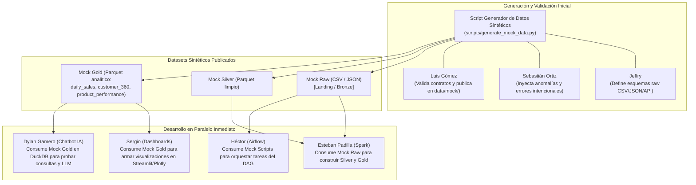
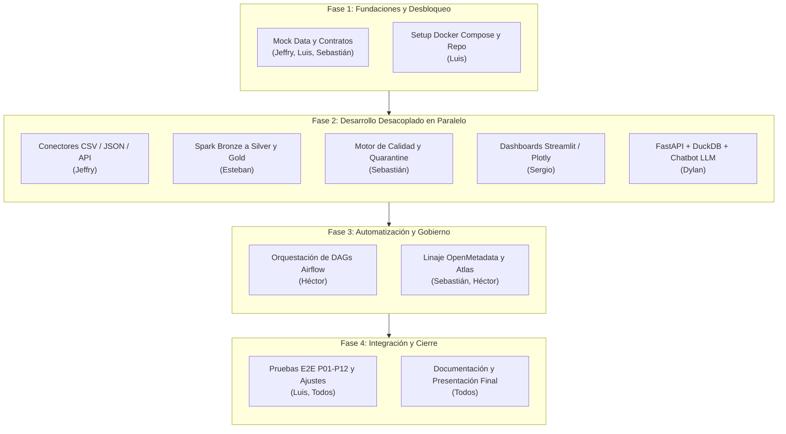
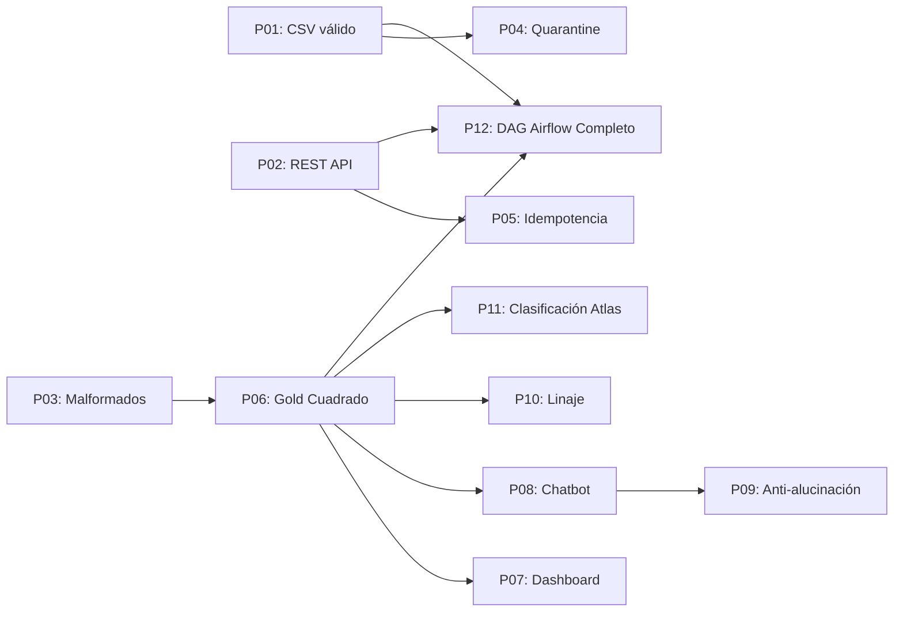

# Plan de Trabajo, Historias de Usuario y Estrategia de Datos

> **Proyecto:** Plataforma Extensible de Datos (Arquitectura Medallion)  
> **Versión del Plan:** 1.0  
> **Fecha:** 19 de octubre de 2026  
> **Rama:** `develop`  
> **Equipo:** Dylan Gamero (Líder), Luis Gómez (Sublíder), Jeffry, Sergio, Esteban Padilla, Héctor, Sebastián Ortiz.

---

## 1. Estrategia de Datos Falsos (Mock Data) y Protocolo de Desbloqueo

Para que los 7 integrantes del equipo puedan desarrollar en paralelo desde el inicio sin depender de que los conectores reales, los clústeres de Spark o los servicios de Airflow estén finalizados, se define una estrategia de desacoplamiento basada en **Mock Data por Capas**.



---

### 1.1 ¿Qué datos faltan y cuáles se deben generar sintéticamente?

El dominio base del proyecto es **Retail / E-commerce analítico**. Se requieren cinco entidades interrelacionadas con volumen representativo (mínimo 5,000 registros para órdenes y 1,000 para clientes/productos) para poner a prueba el rendimiento, las transformaciones y las consultas:

1. **`customers` (Clientes):**
   - Campos: `customer_id`, `first_name`, `last_name`, `email`, `phone`, `country`, `city`, `registration_date`, `status`.
   - Propósito: Alimenta el modelo `customer_360` y pruebas de clasificación PII (datos personales) en Apache Atlas.
   - Formato mock: `customers.json`.

2. **`products` (Productos):**
   - Campos: `product_id`, `product_name`, `category`, `subcategory`, `unit_price`, `cost_price`, `supplier_id`.
   - Propósito: Alimenta agregaciones de categorías y el modelo `product_performance`.
   - Formato mock: `products.json` y `products.csv`.

3. **`orders` y `order_items` (Ventas / Transacciones):**
   - Campos `orders`: `order_id`, `customer_id`, `order_date`, `order_status` (completed, cancelled, returned), `shipping_country`, `payment_method`.
   - Campos `order_items`: `item_id`, `order_id`, `product_id`, `quantity`, `unit_price`, `discount_amount`, `tax_amount`, `total_amount`.
   - Propósito: Alimenta `daily_sales`, `customer_360` y el chatbot.
   - Formato mock: `orders.csv`, `order_items.csv` y respuesta simulada de API REST `api_orders_payload.json`.

4. **`returns` (Devoluciones):**
   - Campos: `return_id`, `order_id`, `product_id`, `return_date`, `reason`, `refund_amount`.
   - Propósito: Permite calcular métricas de devoluciones en `daily_sales` y `product_performance`.
   - Formato mock: `returns.csv`.

5. **`dirty_records` (Datos sucios para pruebas de Quarantine):**
   - Un 5% a 10% del dataset sintético incluirá deliberadamente:
     - Fechas imposibles (e.g. `2026-02-31`, fechas futuras al 2099 o texto `invalid_date`).
     - Claves foráneas inexistentes (e.g. `customer_id = 999999`).
     - Precios negativos (`unit_price < 0`) o cantidades en cero (`quantity = 0`).
     - Emails malformados o nulos en campos obligatorios.
   - Propósito: Validar que el motor de calidad de Sebastián Ortiz y Spark Silver separen estos registros hacia la zona **Quarantine** sin detener el flujo general.

---

### 1.2 ¿Quién genera la data falsa y a quién se la entrega?

| Emisor / Responsable | Artefacto / Archivo Generado | Formato / Ubicación | Receptor (Consumidor) | Impacto / Desbloqueo |
| :--- | :--- | :--- | :--- | :--- |
| **Jeffry** (apoyado por Luis) | `scripts/generate_mock_data.py` con datos crudos (`orders.csv`, `customers.json`, `products.csv`, `api_stream.json`) | `data/mock/raw/` y bucket MinIO `landing/mock/` | **Esteban Padilla** (Spark) y **Jeffry** (Conectores) | Permite construir los transformadores Spark y probar los conectores locales inmediatamente. |
| **Sebastián Ortiz** | Inyección de casos inválidos (`dirty_data.csv`) y catálogo de reglas de calidad | `data/mock/raw/corrupt/` y `config/quality_rules/rules.json` | **Esteban Padilla** (Silver) y **Sebastián Ortiz** (Quarantine) | Desbloquea el filtro de calidad en Spark y el almacenamiento de registros rechazados en Quarantine. |
| **Luis Gómez** | Muestras procesadas de capa Gold sintética (`daily_sales.parquet`, `customer_360.parquet`, `product_performance.parquet`) | `data/mock/gold/` | **Sergio** (Dashboards) y **Dylan Gamero** (Chatbot) | **Desbloqueo crítico:** Permite que Sergio empiece a maquetar Streamlit y Dylan empiece a calibrar prompts y DuckDB sin esperar a que Spark procese la data real. |
| **Luis Gómez** | Especificación OpenAPI simulada de la API REST de ventas | `data/mock/api/mock_sales_api.json` | **Jeffry** (Conector API REST) y **Héctor** (DAGs) | Permite a Jeffry codificar el conector HTTP con paginación y a Héctor armar los operadores de llamada en Airflow. |

---

## 2. Plan Paso a Paso de Implementación



### Paso 1: Inicialización de Datos Falsos y Contratos
1. Luis Gómez inicializa la estructura de carpetas estándar en el repositorio según el Capítulo 14 del documento técnico.
2. Jeffry y Sebastián ejecutan el script de datos falsos generando `data/mock/raw/` y `data/mock/gold/`.
3. Luis documenta los contratos de datos (nombres de columnas, tipos y grano analítico) en `documentation/contracts/`.
4. Sergio y Dylan descargan los archivos Parquet de `data/mock/gold/` y validan que sus entornos de desarrollo leen correctamente los datos con DuckDB y Pandas.

### Paso 2: Desarrollo Desacoplado en Paralelo
- **Jeffry:** Crea `base_connector.py`, `csv_connector.py`, `json_connector.py` y `rest_api_connector.py` usando `data/mock/raw/` como origen y MinIO local como destino.
- **Esteban:** Implementa transformaciones PySpark desde Landing/Bronze a Silver con limpieza y tipado, consumiendo las anomalías provistas por Sebastián.
- **Sebastián:** Desarrolla los módulos de verificación de reglas (nulos, rangos, unicidad) y escribe el escritor de Quarantine en formato Parquet/JSON.
- **Sergio:** Diseña las vistas en Streamlit/Plotly para `daily_sales` y `customer_360` usando la capa mock de Gold.
- **Dylan:** Configura la API en FastAPI, integra DuckDB sobre los archivos Gold, configura el validador SQL seguro (solo `SELECT`) y afina los prompts para traducción lenguaje natural -> SQL.
- **Héctor:** Levanta el contenedor de Airflow, crea las conexiones hacia MinIO y diseña los DAGs iniciales con tareas simuladas (`DummyOperator` / `PythonOperator`).

### Paso 3: Integración E2E y Sustitución de Mocks por Flujo Real
1. Esteban conecta sus scripts de Spark al bucket real de MinIO poblado por los conectores de Jeffry.
2. Esteban genera los Parquet reales en Gold.
3. Sergio y Dylan cambian la ruta de lectura de DuckDB y Streamlit desde `data/mock/gold/` a `minio/gold/`.
4. Héctor reemplaza las tareas simuladas de Airflow por los disparadores reales de conectores y `spark-submit`.
5. Sebastián y Héctor configuran los emitores de metadatos para OpenMetadata y Apache Atlas.

### Paso 4: Pruebas de Aceptación P01 a P12
Se ejecuta la matriz de pruebas funcionales y técnicas del Capítulo 17 y se corrigen discrepancias.

---

## 3. Catálogo Detallado de Historias de Usuario (US)

---

### Módulo: Arquitectura, Estructura e Integración
**Responsable:** Luis Gómez (Sublíder)

#### US-01: Estructura del Repositorio, Contratos de Datos y Entorno Base Docker
- **Rol:** Como Sublíder de Arquitectura
- **Quiero:** Definir el árbol de directorios del proyecto, los contratos técnicos de esquemas y el archivo `docker-compose.yml` base
- **Para:** Garantizar un entorno de trabajo estandarizado, sin conflictos entre integrantes y reproducible en local.
- **Complejidad:** Alta | **Prioridad:** P0 (Bloqueante inicial)
- **Colaboradores:** Jeffry, Esteban Padilla, Dylan Gamero.

##### Especificación Paso a Paso:
1. Crear la estructura de carpetas descrita en el Capítulo 14 (`app/`, `ingestion/`, `processing/`, `orchestration/`, `governance/`, `config/`, `tests/`, `data/mock/`).
2. Redactar las especificaciones de esquemas en formato JSON Schema para cada capa (Landing, Bronze, Silver, Gold).
3. Configurar `.env.example`, `.gitignore` y `requirements.txt` con las librerías base (pyspark, duckdb, fastapi, streamlit, plotly, boto3, minio, pydantic, pytest).
4. Redactar `docker-compose.yml` que orqueste:
   - MinIO (puertos 9000 para API S3 y 9001 para consola web).
   - Apache Airflow (webserver, scheduler, postgres).
   - FastAPI Backend (puerto 8000).
   - Streamlit Frontend (puerto 8501).

##### Pruebas de Funcionamiento:
- **Prueba Técnica T01.1 (Docker Up):** Ejecutar `docker compose up -d` y verificar mediante healthchecks que MinIO responde en `http://localhost:9000` y Airflow en `http://localhost:8080`.
- **Prueba Técnica T01.2 (Validación de Esquemas):** Ejecutar test con `jsonschema` que valide los archivos mock contra los esquemas JSON definidos.
- **Criterio de Aceptación (Gherkin):**
  ```gherkin
  Given que un desarrollador clona el repositorio en una máquina limpia
  When ejecuta "docker compose up -d" y corre "pytest tests/unit/test_env.py"
  Then todos los servicios base arrancan en estado healthy y las variables de entorno se cargan sin arrojar advertencias de configuración faltante.
  ```

---

#### US-02: Pipeline de Integración End-to-End y Verificación de Compatibilidad
- **Rol:** Como Sublíder de Arquitectura
- **Quiero:** Desarrollar un test de integración automatizado de punta a punta que valide el tránsito completo de un lote de prueba
- **Para:** Asegurar que las interfaces entre conectores, Spark, DuckDB, dashboards y chatbot funcionen armónicamente.
- **Complejidad:** Alta | **Prioridad:** P1
- **Colaboradores:** Todos los integrantes.

##### Especificación Paso a Paso:
1. Crear un script de prueba de integración en `tests/end_to_end/test_pipeline_e2e.py`.
2. Ejecutar la ingesta de un lote sintético a Landing en MinIO.
3. Llamar al job de Spark para generar Bronze, Silver y Gold.
4. Consultar Gold vía DuckDB y comparar métricas clave (total ventas, número de órdenes) contra los resultados esperados.
5. Invocar el endpoint de FastAPI del Chatbot con una pregunta parametrizada sobre ese lote y verificar que responda con la cifra calculada.

##### Pruebas de Funcionamiento:
- **Prueba T02.1 (P06 / P12 de aceptación):** Ejecución continua del pipeline completo con verificación de código de salida 0.
- **Criterio de Aceptación:**
  ```gherkin
  Given un lote de 100 órdenes sintéticas ingresado en Landing
  When se ejecuta el flujo completo de extremo a extremo
  Then la capa Gold contiene exactamente las órdenes consolidadas, los registros anómalos residen en Quarantine, y el backend de consulta devuelve las métricas calculadas con 100% de consistencia.
  ```

---

### Módulo: Ingesta de Datos y Conectores
**Responsable:** Jeffry

#### US-03: Generador de Datos Sintéticos (Mock Data) y Semillas para el Equipo
- **Rol:** Como Ingeniero de Ingesta
- **Quiero:** Construir un script parametrizable para generar datos sintéticos en CSV, JSON y Parquet con casos válidos y defectuosos
- **Para:** Proveer inmediatamente los datos de prueba que desbloquean el desarrollo de Spark, Dashboards, Chatbot y Airflow.
- **Complejidad:** Media | **Prioridad:** P0 (Inmediata)
- **Colaboradores:** Sebastián Ortiz (reglas de error), Luis Gómez (esquemas).

##### Especificación Paso a Paso:
1. Crear el script `scripts/generate_mock_data.py` utilizando librerías estándar o Faker.
2. Generar 1,000 clientes (`data/mock/raw/customers.json`) y 200 productos (`data/mock/raw/products.csv`).
3. Generar 5,000 órdenes de venta con sus respectivos ítems (`orders.csv`, `order_items.csv`), distribuidos en fechas de los últimos 6 meses.
4. Generar un archivo de devoluciones (`returns.csv`).
5. Inyectar un 5% de datos erróneos en un archivo independiente `orders_dirty.csv`.
6. Generar una versión precocinada en Parquet de las tablas Gold (`daily_sales.parquet`, `customer_360.parquet`, `product_performance.parquet`) y colocarla en `data/mock/gold/`.

##### Pruebas de Funcionamiento:
- **Prueba T03.1:** Ejecutar `python scripts/generate_mock_data.py --records 5000` y verificar que los archivos se creen en menos de 10 segundos en las rutas correspondientes.
- **Prueba T03.2:** Verificar mediante script de test que los IDs entre órdenes, clientes y productos mantengan coherencia referencial (excepto en los marcados como dirty).
- **Criterio de Aceptación:**
  ```gherkin
  Given el script de generación de mock data ejecutado
  When los desarrolladores de Dashboard, Chatbot y Spark leen las rutas data/mock/
  Then cada integrante cuenta con archivos funcionales con esquemas idénticos a los contratos de producción.
  ```

---

#### US-04: Conectores de Ingesta para Archivos CSV y JSON con Registro en Landing y Bronze
- **Rol:** Como Ingeniero de Ingesta
- **Quiero:** Desarrollar el contrato abstracto `BaseConnector` y las implementaciones para CSV y JSON hacia MinIO
- **Para:** Almacenar los datos originales en Landing de forma inmutable y volcarlos a Bronze en formato Parquet con sus metadatos de control.
- **Complejidad:** Alta | **Prioridad:** P1
- **Colaboradores:** Luis Gómez, Esteban Padilla.

##### Especificación Paso a Paso:
1. Crear `ingestion/base_connector.py` con los métodos abstractos: `configure()`, `validate()`, `fetch()`, `save_landing()`, `save_bronze()`, `emit_metadata()`.
2. Crear `ingestion/csv_connector.py` implementando lectura por bloques (chunks), validación de encabezados delimitados y subida multipart a MinIO.
3. Crear `ingestion/json_connector.py` con validación de estructura jerárquica.
4. En Landing, almacenar el archivo tal cual se recibió bajo la ruta `landing/{source_id}/{YYYY}/{MM}/{DD}/{ingestion_id}.{ext}`.
5. En Bronze, convertir a formato Parquet agregando las columnas técnicas de auditoría: `_ingestion_id`, `_ingested_at`, `_source_file`.

##### Pruebas de Funcionamiento:
- **Prueba T04.1 (P01 de aceptación):** Cargar un CSV de 10,000 filas. Verificar que el objeto en MinIO Landing sea idéntico al original (hash SHA-256) y que en Bronze exista el Parquet legible.
- **Prueba T04.2 (P03 de aceptación):** Proporcionar un CSV corrupto (columnas desfasadas). Verificar que el conector capture la excepción, registre el error en los logs y no genere un archivo Bronze roto.
- **Criterio de Aceptación:**
  ```gherkin
  Given un archivo CSV de transacciones ubicado en la entrada
  When se dispara el CSVConnector
  Then el archivo se almacena inalterado en Landing, se genera una tabla Parquet en Bronze con columnas de auditoría y se retorna status "SUCCESS".
  ```

---

#### US-05: Conector Reutilizable para Consumo de APIs REST con Paginación y Resiliencia
- **Rol:** Como Ingeniero de Ingesta
- **Quiero:** Desarrollar un conector para APIs REST con autenticación configurable, manejo de tokens, paginación y control de tasa (rate limiting)
- **Para:** Automatizar la ingesta periódica de ventas externas o datos de tipos de cambio de manera confiable.
- **Complejidad:** Alta | **Prioridad:** P1
- **Colaboradores:** Héctor (integración Airflow).

##### Especificación Paso a Paso:
1. Crear `ingestion/rest_api_connector.py` heredando de `BaseConnector`.
2. Implementar estrategias de paginación (basada en páginas `page/page_size` y basada en cursores `next_token`).
3. Añadir reintentos exponenciales con `backoff` ante errores HTTP 429 (Too Many Requests), 500 y 503.
4. Manejar credenciales exclusivamente desde variables de entorno seguras (Bearer token, API Key o Basic Auth).
5. Guardar la respuesta JSON cruda en Landing y aplanarla a formato tabular en Bronze.

##### Pruebas de Funcionamiento:
- **Prueba T05.1 (P02 de aceptación):** Simular una API con mock server (ej. WireMock o FastAPI mock) que responda 3 páginas de datos y un error 429 transitorio. Verificar que el conector reintente y descargue las 3 páginas completas.
- **Criterio de Aceptación:**
  ```gherkin
  Given un endpoint REST paginado con 300 registros en 3 páginas
  When el RestApiConnector ejecuta la extracción
  Then los 300 registros se recolectan en un único dataset Bronze y los metadatos reflejan record_count = 300 y status = "SUCCESS".
  ```

---

### Módulo: Procesamiento Distribuido (Spark, Silver y Gold)
**Responsable:** Esteban Padilla

#### US-06: Procesamiento, Limpieza y Normalización en Spark (Bronze a Silver)
- **Rol:** Como Ingeniero de Datos
- **Quiero:** Construir el job de Apache Spark que lea los datos de Bronze, aplique tipado, deduplicación y filtros de calidad
- **Para:** Publicar en la zona Silver datasets confiables, limpios y libres de inconsistencias.
- **Complejidad:** Alta | **Prioridad:** P1
- **Colaboradores:** Sebastián Ortiz (Quarantine), Jeffry (Bronze).

##### Especificación Paso a Paso:
1. Crear `processing/silver/clean_orders.py` y `processing/silver/clean_customers.py`.
2. Configurar la sesión de Spark con conectividad S3A hacia MinIO.
3. Castear campos a sus tipos nativos (`order_date` a Timestamp, `unit_price` a Decimal/Double, `quantity` a Integer).
4. Implementar deduplicación basada en clave de negocio (`order_id` + `item_id`), reteniendo el registro con el `_ingested_at` más reciente.
5. Invocar el validador de calidad:
   - Registros conformes -> Guardar en MinIO `silver/retail/orders/` particionado por `year` y `month`.
   - Registros no conformes -> Enrutar a la función de Quarantine.

##### Pruebas de Funcionamiento:
- **Prueba T06.1:** Ejecutar el job con un Bronze que contenga 100 duplicados intencionales. Verificar que en Silver queden exactamente registros únicos.
- **Prueba T06.2:** Medir tiempo de ejecución para 100,000 registros y validar que la memoria de Spark no desborde (optimización de shuffle partitions).
- **Criterio de Aceptación:**
  ```gherkin
  Given un dataset Bronze con datos crudos y duplicados
  When se ejecuta el script de Spark Silver
  Then los datos limpios se escriben en Silver particionados por año/mes y ninguna fila contiene tipos incompatibles ni nulos en claves primarias.
  ```

---

#### US-07: Construcción de Datasets Analíticos en Capa Gold (`daily_sales`, `customer_360`, `product_performance`)
- **Rol:** Como Ingeniero de Datos
- **Quiero:** Crear los jobs de Spark que agregan y transforman los datos de Silver en modelos multidimensionales en Gold
- **Para:** Servir directamente a los dashboards y al chatbot con tablas optimizadas para consulta columnar rápida.
- **Complejidad:** Alta | **Prioridad:** P1
- **Colaboradores:** Sergio (Dashboards), Dylan Gamero (Chatbot).

##### Especificación Paso a Paso:
1. **Modelo `daily_sales`:**
   - Grano: `order_date`, `shipping_country`, `category`.
   - Métricas: `total_revenue` (sum de total_amount completadas), `orders_count` (count distinct order_id), `units_sold`, `avg_ticket`, `returns_count`, `refunded_amount`.
2. **Modelo `customer_360`:**
   - Grano: `customer_id`.
   - Métricas: `first_purchase_date`, `last_purchase_date`, `total_orders`, `lifetime_value` (LTV), `avg_order_value`, `favorite_category`.
   - Aplicar anonimización (hashing o exclusión) en columnas sensibles.
3. **Modelo `product_performance`:**
   - Grano: `product_id`.
   - Métricas: `units_sold`, `gross_revenue`, `return_rate` (devoluciones / ventas), `margin`.
4. Escribir las salidas en MinIO `gold/daily_sales/`, `gold/customer_360/`, `gold/product_performance/` en formato Parquet comprimido con Snappy.

##### Pruebas de Funcionamiento:
- **Prueba T07.1 (P06 de aceptación):** Contrastar la suma de `daily_sales.total_revenue` contra la suma manual de los registros completados de Silver. La diferencia debe ser exactamente 0.00.
- **Prueba T07.2 (Idempotencia - P05):** Re-ejecutar el job sobre el mismo período de fechas y verificar que las particiones se sobreescriban sin duplicar los números.
- **Criterio de Aceptación:**
  ```gherkin
  Given los datos limpios en la capa Silver
  When se procesan los modelos de la capa Gold
  Then se generan las tres tablas analíticas en formato Parquet con las métricas cuadradas matemáticamente respecto a Silver.
  ```

---

### Módulo: Calidad de Datos, Quarantine y Gobernanza
**Responsable:** Sebastián Ortiz

#### US-08: Motor de Validación de Reglas de Calidad y Gestión de Quarantine
- **Rol:** Como Especialista en Calidad de Datos
- **Quiero:** Diseñar un motor de reglas desacoplado que evalúe datasets y envíe los registros anómalos a la zona Quarantine
- **Para:** Aislar registros inválidos impidiendo que ensucien los reportes analíticos y almacenar evidencia para auditoría.
- **Complejidad:** Media | **Prioridad:** P1
- **Colaboradores:** Esteban Padilla (Spark Silver), Héctor (Airflow).

##### Especificación Paso a Paso:
1. Crear el archivo de configuración `config/quality_rules/retail_rules.json` especificando:
   - Campos no nulos obligatorios (`order_id`, `customer_id`, `order_date`).
   - Rangos permitidos (`unit_price > 0`, `quantity > 0`, `discount_amount >= 0`).
   - Expresiones regulares para fechas y formatos.
2. Implementar `processing/quality/validator.py` consumible desde Spark o Python puro.
3. Diseñar el repositorio de Quarantine en MinIO: `quarantine/{dataset_name}/{YYYY}/{MM}/{DD}/`.
4. Cada fila en Quarantine debe enriquecerse con:
   - `_error_code`: Código del error (ej. `ERR_NULL_KEY`, `ERR_NEGATIVE_PRICE`).
   - `_error_message`: Explicación legible.
   - `_rejected_at`: Timestamp UTC.
   - `_original_payload`: Fila cruda original para trazabilidad.

##### Pruebas de Funcionamiento:
- **Prueba T08.1 (P04 de aceptación):** Pasar un lote con 50 registros corruptos conocidos. Verificar que exactamente los 50 registros terminen en el bucket de Quarantine con su metadata correspondiente.
- **Prueba T08.2:** Verificar que un registro con advertencia no crítica (ej. formato de teléfono no estándar) pase a Silver con un flag de advertencia en lugar de ser rechazado.
- **Criterio de Aceptación:**
  ```gherkin
  Given un conjunto de registros de ventas con errores de negocio
  When el validador de calidad ejecuta las reglas definidas
  Then los registros inválidos se almacenan en Quarantine con el motivo del rechazo y no aparecen en Silver.
  ```

---

#### US-09: Integración de Catálogo y Linaje con OpenMetadata y Clasificación con Apache Atlas
- **Rol:** Como Especialista en Gobierno de Datos
- **Quiero:** Registrar los metadatos técnicos de las capas Medallion en OpenMetadata y aplicar clasificaciones de seguridad y datos sensibles en Apache Atlas
- **Para:** Dar visibilidad del linaje de extremo a extremo a los usuarios y gobernar el acceso a datos personales (PII).
- **Complejidad:** Media | **Prioridad:** P2
- **Colaboradores:** Héctor (automatización de linaje), Luis Gómez.

##### Especificación Paso a Paso:
1. Configurar el conector de metadatos de OpenMetadata (`governance/openmetadata/ingest_metadata.py`) para escanear las tablas en MinIO/DuckDB.
2. Documentar descripciones de tablas, columnas y tipos en OpenMetadata.
3. Configurar el gráfico de linaje declarando la relación: `API/CSV -> Landing -> Bronze -> Silver -> Gold (daily_sales, customer_360)`.
4. En Apache Atlas (`governance/atlas/classify_entities.py`), crear las clasificaciones: `PII`, `SENSITIVE_FINANCIAL`, `PUBLIC`.
5. Asociar las etiquetas de Atlas a los campos `email`, `phone` (PII) y `revenue`, `unit_price` (SENSITIVE_FINANCIAL) según el Cuadro 12.1.

##### Pruebas de Funcionamiento:
- **Prueba T09.1 (P10 de aceptación):** Ingresar a la interfaz web de OpenMetadata y verificar que la búsqueda del dataset `daily_sales` muestre su linaje upstream hasta la fuente CSV/API.
- **Prueba T09.2 (P11 de aceptación):** Consultar en Apache Atlas la entidad `customers` y comprobar que el atributo `email` posea la etiqueta `PII`.
- **Criterio de Aceptación:**
  ```gherkin
  Given las tablas generadas en Bronze, Silver y Gold
  When se ejecutan los pipelines de metadata
  Then OpenMetadata despliega el árbol de linaje completo y Apache Atlas refleja las clasificaciones de confidencialidad de acuerdo a la matriz de gobernanza.
  ```

---

### Módulo: Orquestación y Automatización (Apache Airflow)
**Responsable:** Héctor

#### US-10: Configuración del Clúster Airflow y Creación del DAG Principal del Pipeline
- **Rol:** Como Ingeniero de Operaciones / DataOps
- **Quiero:** Diseñar e implementar el DAG maestro en Apache Airflow que orqueste la ejecución ordenada de ingesta, Spark y validación
- **Para:** Lograr un flujo de datos desatendido, automático, con control estricto de dependencias y tiempos.
- **Complejidad:** Media | **Prioridad:** P1
- **Colaboradores:** Jeffry, Esteban Padilla, Sebastián Ortiz.

##### Especificación Paso a Paso:
1. Crear el DAG `orchestration/dags/dag_medallion_pipeline.py`.
2. Definir las tareas respetando el diagrama de la Figura 10.1:
   - `validate_environment`: Comprobar conectividad a MinIO y recursos disponibles.
   - `extract_and_land`: Ejecutar conectores de ingesta hacia Landing.
   - `process_bronze`: Generar capas Bronze.
   - `process_silver_and_quarantine`: Ejecutar PySpark Silver y validar calidad.
   - `process_gold`: Construir agregaciones Gold.
   - `quality_gate`: Validar que las métricas Gold no tengan anomalías numéricas.
   - `publish_metrics`: Registrar estado final de la ejecución.
3. Configurar dependencias de tareas con operadores de flujo (`t1 >> t2 >> t3 >> t4 >> t5 >> t6 >> t7`).
4. Configurar alertas por correo o log ante fallos en cualquier tarea.

##### Pruebas de Funcionamiento:
- **Prueba T10.1 (P12 de aceptación):** Disparar el DAG manualmente desde la UI o CLI de Airflow (`airflow dags trigger dag_medallion_pipeline`). Verificar que todas las tareas culminen en estado `success` (color verde).
- **Prueba T10.2 (Fallo controlado):** Provocar un error en la tarea de Landing y verificar que las tareas downstream (`process_silver`, `process_gold`) queden en estado `upstream_failed` sin ejecutar transformaciones con datos incompletos.
- **Criterio de Aceptación:**
  ```gherkin
  Given el DAG maestro configurado en Airflow
  When se programa su ejecución diaria o se activa manualmente
  Then todas las tareas se ejecutan secuencialmente de Landing a Gold sin requerir intervención manual.
  ```

---

#### US-11: Observabilidad, Reintentos e Idempotencia en la Orquestación
- **Rol:** Como Ingeniero de Operaciones / DataOps
- **Quiero:** Configurar políticas de reintento automático, manifiestos de ejecución y limpieza de particiones en Airflow
- **Para:** Asegurar que si una tarea falla por problemas transitorios de red se recupere automáticamente sin duplicar datos en reprocesamientos.
- **Complejidad:** Media | **Prioridad:** P2
- **Colaboradores:** Esteban Padilla.

##### Especificación Paso a Paso:
1. Configurar `retries = 3` y `retry_delay = timedelta(minutes=2)` en los `default_args` del DAG.
2. Pasar `execution_date` o `run_id` como parámetro a todos los jobs de Spark y conectores para etiquetar los manifiestos de ejecución.
3. Implementar un hook de limpieza previa: antes de reescribir una partición en Gold para la fecha X, verificar que la carpeta de destino esté limpia o usar modo `overwrite`.
4. Exportar métricas de ejecución (tiempo por tarea, registros procesados) a una tabla de control operativa en SQLite/Postgres.

##### Pruebas de Funcionamiento:
- **Prueba T11.1 (P05 de aceptación):** Ejecutar dos veces consecutivas el mismo DAG con los mismos parámetros de fecha. Verificar que el número de registros en la tabla Gold final sea exactamente idéntico tras ambas ejecuciones.
- **Criterio de Aceptación:**
  ```gherkin
  Given una corrida de Airflow previamente finalizada con éxito
  When el operador reejecuta la misma corrida
  Then el sistema sobrescribe las particiones afectadas de forma limpia sin generar filas duplicadas ni alterar totales históricos.
  ```

---

### Módulo: Capa de Consulta y Chatbot de Analítica con IA
**Responsable:** Dylan Gamero (Líder)

#### US-12: Capa de Consulta SQL sobre Parquet con DuckDB y API Backend en FastAPI
- **Rol:** Como Líder Técnico y Desarrollador Backend
- **Quiero:** Construir un servicio FastAPI que exponga endpoints de consulta analítica conectados a archivos Gold mediante DuckDB
- **Para:** Proveer una capa de datos estandarizada, veloz y unificada tanto para los dashboards como para el chatbot.
- **Complejidad:** Alta | **Prioridad:** P1
- **Colaboradores:** Sergio (contrato con Frontend), Esteban Padilla (esquema Gold).

##### Especificación Paso a Paso:
1. Crear el módulo `app/backend/query_engine/duckdb_client.py` configurando DuckDB con la extensión `httpfs` para consultar Parquet directamente desde MinIO o almacenamiento local.
2. Crear vistas SQL sobre los archivos Gold: `v_daily_sales`, `v_customer_360`, `v_product_performance`.
3. Crear endpoints REST en `app/backend/api/`:
   - `GET /api/v1/metrics/daily-sales`: Métricas agregadas por rango de fechas y país.
   - `GET /api/v1/metrics/top-products`: Ranking de productos por ventas.
   - `POST /api/v1/query/execute`: Ejecución de consultas SQL validadas.
4. Implementar control de tiempo límite (timeout de 5 segundos) y límite de filas (máximo 1,000 registros).

##### Pruebas de Funcionamiento:
- **Prueba T12.1:** Realizar una consulta de agregación sobre 100,000 registros Parquet con DuckDB y verificar que el tiempo de respuesta sea inferior a 250 ms.
- **Prueba T12.2:** Probar concurrencia con 10 solicitudes simultáneas y comprobar que no existan bloqueos de base de datos ni caídas del servicio FastAPI.
- **Criterio de Aceptación:**
  ```gherkin
  Given los archivos Gold almacenados en formato Parquet
  When un cliente consulta el endpoint /api/v1/metrics/daily-sales con filtros de fecha
  Then la API responde en menos de 500ms con un JSON estructurado de las ventas agrupadas.
  ```

---

#### US-13: Asistente Conversacional (Chatbot IA) con Text-to-SQL Seguro y Explicabilidad
- **Rol:** Como Líder Técnico y Desarrollador de IA
- **Quiero:** Implementar el módulo conversacional con un LLM que traduzca preguntas en lenguaje natural a consultas SQL controladas sobre DuckDB
- **Para:** Permitir a usuarios de negocio consultar indicadores analíticos conversacionalmente sin requerir conocimientos técnicos de SQL.
- **Complejidad:** Alta | **Prioridad:** P1
- **Colaboradores:** Luis Gómez (seguridad y validación SQL).

##### Especificación Paso a Paso:
1. Diseñar el pipeline conversacional en `app/backend/services/chatbot_service.py` siguiendo la arquitectura de la Figura 9.1:
   - Recepción de la pregunta del usuario.
   - Inyección en el prompt del esquema de las vistas autorizadas y catálogo de métricas oficiales.
   - Generación de la consulta SQL por parte del LLM.
2. Implementar el **Validador SQL de Seguridad** (`app/backend/services/sql_guard.py`):
   - Rechazar de forma estricta cualquier sentencia que contenga `INSERT`, `UPDATE`, `DELETE`, `DROP`, `ALTER`, `TRUNCATE`, `EXEC`, o comentarios `--` y `/*`.
   - Permitir única y exclusivamente sentencias `SELECT`.
   - Limitar consultas a las vistas Gold autorizadas (impedir acceso a tablas internas o metadata).
   - Inyectar automáticamente `LIMIT 100` si la consulta no define límite.
3. Ejecutar la consulta en DuckDB.
4. Si la consulta tiene éxito: enviar los resultados al LLM para generar una síntesis en lenguaje natural y sugerir una visualización si aplica.
5. Si los datos son insuficientes o la pregunta es ambigua: responder amablemente explicando la limitación sin alucinar números.

##### Pruebas de Funcionamiento:
- **Prueba T13.1 (P08 de aceptación):** Preguntar *"¿Cuánto vendimos en total el último mes?"*. Verificar que la consulta SQL generada sume `total_revenue`, que se ejecute en DuckDB y que la respuesta textual cite la cifra exacta obtenida.
- **Prueba T13.2 (P09 de aceptación / Anti-alucinación):** Preguntar *"¿Cuál es la proyección de ventas para el año 2045?"*. Verificar que el chatbot responda aclarando que solo cuenta con datos históricos y no genere una cifra inventada.
- **Prueba T13.3 (Inyección SQL / Seguridad):** Enviar *"Dime las ventas; DROP TABLE v_daily_sales; --"*. Verificar que el Validador SQL bloquee la petición arrojando un error `400 Bad Request: Operación no permitida`.
- **Criterio de Aceptación:**
  ```gherkin
  Given un usuario interactuando con el chatbot de analítica
  When formula una pregunta de negocio en lenguaje natural
  Then el chatbot formula un SELECT válido, obtiene datos de DuckDB y redacta una respuesta coherente respaldada por las cifras reales del sistema.
  ```

---

### Módulo: Dashboards y Capa de Presentación
**Responsable:** Sergio

#### US-14: Dashboard Interactivo de Negocio (Retail KPIs y Filtros) en Streamlit
- **Rol:** Como Desarrollador Frontend / BI
- **Quiero:** Construir una aplicación web interactiva en Streamlit conectada a la capa Gold
- **Para:** Permitir a los tomadores de decisiones explorar ventas, clientes y desempeño de productos mediante gráficos y filtros dinámicos.
- **Complejidad:** Alta | **Prioridad:** P1
- **Colaboradores:** Esteban Padilla (validación de KPIs), Dylan Gamero (integración API).

##### Especificación Paso a Paso:
1. Crear la aplicación base en `app/frontend/dashboards/main.py`.
2. Crear pestañas de navegación:
   - **Visión General de Ventas:** Tarjetas con KPIs principales (Total Ingresos, Total Pedidos, Ticket Promedio, Tasa de Devolución), gráfico de líneas interactivo de tendencia temporal con Plotly y gráfico de barras por categoría.
   - **Análisis de Clientes:** Distribución de clientes por país, frecuencia de compra y segmentación por LTV.
   - **Rendimiento de Productos:** Tabla interactiva con búsqueda de productos más vendidos y márgenes.
3. Incorporar barra lateral con filtros: rango de fechas (selector de calendario), selector multichoice de países y selector de categorías.
4. Conectar la interfaz con el backend FastAPI o consultar directamente las vistas Gold de DuckDB compartiendo la misma lógica de cálculo.

##### Pruebas de Funcionamiento:
- **Prueba T14.1 (P07 de aceptación):** Abrir el dashboard en el navegador y comprobar que los números exhibidos en los KPIs coincidan exactamente con una consulta SQL directa sobre `daily_sales`.
- **Prueba T14.2 (Reactividad de filtros):** Modificar el filtro de fecha a un mes específico. Comprobar que los gráficos se actualicen en menos de 1 segundo reflejando únicamente ese rango.
- **Criterio de Aceptación:**
  ```gherkin
  Given un usuario accediendo al dashboard en Streamlit
  When aplica filtros de país y período de tiempo
  Then todos los gráficos y KPIs se recalculan instantáneamente manteniendo total consistencia con las cifras oficiales de la base Gold.
  ```

---

#### US-15: Interfaz Integrada para el Chatbot Conversacional y Monitor de Calidad
- **Rol:** Como Desarrollador Frontend / BI
- **Quiero:** Integrar el componente de Chatbot conversacional dentro de la aplicación Streamlit y una vista de métricas de calidad y Quarantine
- **Para:** Brindar una experiencia de usuario unificada donde se pueda consultar tanto visualmente como por chat y auditar la salud de los datos.
- **Complejidad:** Media | **Prioridad:** P1
- **Colaboradores:** Dylan Gamero (Chatbot), Sebastián Ortiz (Quarantine).

##### Especificación Paso a Paso:
1. Crear la pestaña **"Asistente IA"** en Streamlit utilizando `st.chat_message` y `st.chat_input`.
2. Conectar el chat con el endpoint `/api/v1/chatbot/ask` de FastAPI mediante streaming o solicitud asíncrona.
3. Si la respuesta incluye datos tabulares o sugerencia de gráfico, renderizar el dataframe o gráfico Plotly directamente en la conversación.
4. Crear la pestaña **"Salud del Pipeline"**:
   - Tarjetas con volumen de registros procesados en Landing, Bronze, Silver y Gold.
   - Tabla de registros rechazados en Quarantine con visualización de los motivos de error (`ERR_NULL_KEY`, `ERR_INVALID_DATE`).

##### Pruebas de Funcionamiento:
- **Prueba T15.1:** Escribir una pregunta en el chat y verificar que el historial de mensajes se conserve durante la sesión.
- **Prueba T15.2:** Verificar que en la pestaña de calidad se muestre la cantidad exacta de registros en Quarantine reportados por el motor de Sebastián.
- **Criterio de Aceptación:**
  ```gherkin
  Given la interfaz web en ejecución
  When el usuario envía una consulta en el chat y luego navega al monitor de salud
  Then recibe la respuesta contextualizada del chatbot con sus gráficos asociados y puede verificar el estado de los datos en Quarantine en la misma plataforma.
  ```

---

## 4. Matriz de Trazabilidad entre Integrantes, Datos y Entregables

La siguiente tabla resume qué entrega cada integrante, a quién, en qué formato y qué desbloquea esa entrega:

| Responsable | Entregable Concreto | Receptor Principal | Formato / Ubicación | Qué desbloquea |
| :--- | :--- | :--- | :--- | :--- |
| **Luis Gómez** | Contratos de esquemas JSON y estructura de carpetas | Todo el equipo | `config/datasets/*.json` y repo | Desarrollo sin colisiones de nombres ni ramas. |
| **Jeffry** | Script de Mock Data y archivos crudos sintéticos | Esteban Padilla, Héctor | `scripts/generate_mock_data.py` y `data/mock/raw/` | Desarrollo de transformaciones Spark e ingesta sin esperar fuentes reales. |
| **Luis Gómez** | Muestras Parquet de capa Gold | Sergio, Dylan Gamero | `data/mock/gold/*.parquet` | Maquetación inmediata de Dashboards y Chatbot IA en paralelo desde el inicio. |
| **Sebastián Ortiz** | Inyección de errores sintéticos y reglas de validación | Esteban Padilla, Héctor | `config/quality_rules/*.json` y `data/mock/raw/corrupt/` | Construcción de filtros de calidad y zona Quarantine. |
| **Jeffry** | Conectores CSV, JSON y REST API terminados | Esteban Padilla, Héctor | `ingestion/*_connector.py` | Poblado real continuo de Landing y Bronze en MinIO. |
| **Esteban Padilla** | Jobs PySpark de Silver y Gold | Sergio, Dylan, Héctor | `processing/silver/`, `processing/gold/` | Sustitución de los datos mock por los datos procesados reales. |
| **Dylan Gamero** | Motor de consulta DuckDB y API Backend | Sergio (Frontend) | `app/backend/api/` (puerto 8000) | Consumo unificado de datos para visualizaciones y consultas. |
| **Dylan Gamero** | Servicio de Chatbot IA con validación SQL | Sergio (Frontend) | `app/backend/services/chatbot_service.py` | Pestaña conversacional operativa en la UI. |
| **Sergio** | Dashboards en Streamlit y UI de Chatbot | Usuarios finales y equipo | `app/frontend/dashboards/` (puerto 8501) | Experiencia visual interactiva y exploración analítica. |
| **Héctor** | DAGs de orquestación en Apache Airflow | Todo el equipo | `orchestration/dags/` | Automatización end-to-end de todo el flujo de datos. |
| **Sebastián Ortiz** | Documentación de linaje y catálogo en OpenMetadata / Atlas | Auditores y equipo | `governance/` | Trazabilidad y gobernanza de la plataforma. |

---

## 5. Protocolo de Pruebas de Aceptación (Verificación Cruzada)

Al completar las Historias de Usuario, se ejecutarán las 12 pruebas formales del Capítulo 17 del Documento Técnico:



1. **P01 (CSV) & P02 (API):** Jeffry y Héctor demuestran la ingesta hacia Landing y Bronze.
2. **P03 & P04 (Errores y Quarantine):** Sebastián y Esteban demuestran el rechazo automático de filas corruptas sin abortar el job.
3. **P05 (Idempotencia):** Esteban y Héctor corren el DAG dos veces y demuestran que las filas en Gold no varían.
4. **P06 (Cálculo Gold):** Esteban y Sergio validan que `SUM(total_revenue)` en Gold sea igual al valor auditado.
5. **P07 (Dashboards):** Sergio demuestra los filtros dinámicos y la consistencia de los gráficos.
6. **P08 & P09 (Chatbot):** Dylan demuestra que ante preguntas de ventas responde con la cifra real, y ante preguntas sin datos explica la limitación sin inventar información.
7. **P10 & P11 (Linaje y Gobernanza):** Sebastián demuestra el recorrido en OpenMetadata y la etiqueta `PII` en Apache Atlas.
8. **P12 (Orquestación general):** Héctor y Luis ejecutan el DAG maestro que corre todas las etapas secuencialmente con resultado 100% exitoso.
