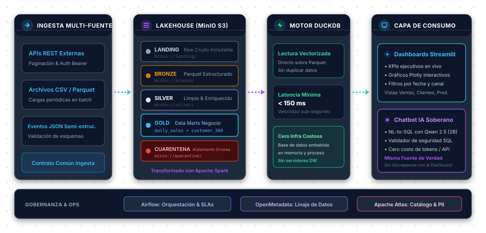
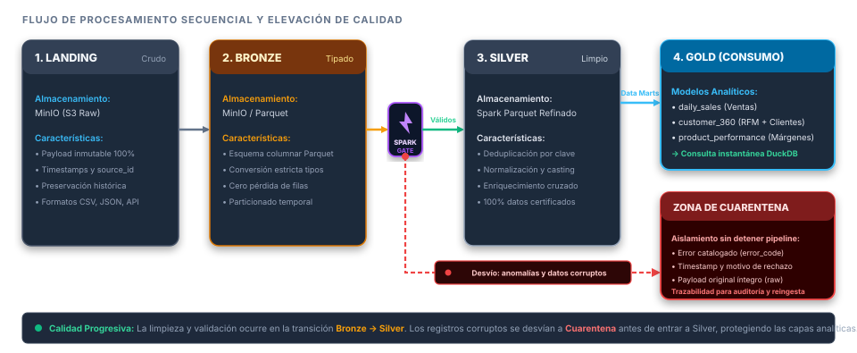
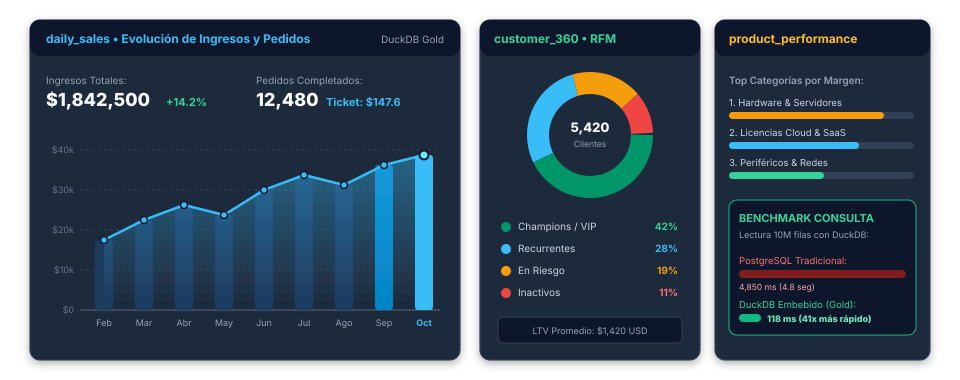
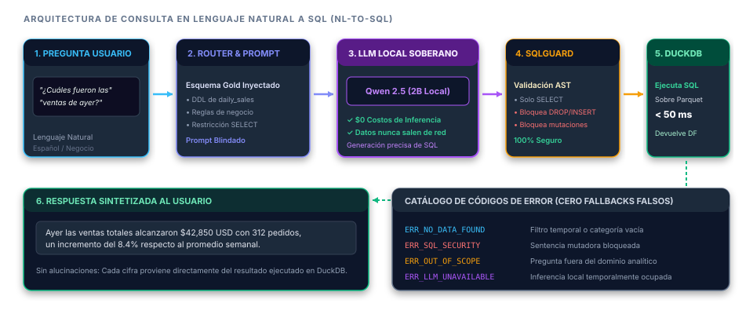

<!-- Slide 1: Portada -->

  

    
      ARQUITECTURA LAKEHOUSE • MEDALLION 2.0 • IA SOBERANA LOCAL
    
  

  
  <h1 style="font-size: 2.2rem; color: #ffffff; margin-bottom: 8px;">
    Plataforma Extensible de Datos y Analítica
  </h1>
  
  <h2 style="font-size: 1.15rem; color: #94a3b8; max-width: 800px; margin: 0 auto 24px auto;">
    Ingeniería de datos integral con MinIO, Apache Spark, aceleración analítica con DuckDB y Chatbot con LLM Soberano (Qwen 2.5) sin costes de API.
  </h2>

  

    

      
Almacenamiento

      
MinIO S3 Lakehouse

    

    

      
Procesamiento

      
Apache Spark 3.5

    

    

      
Motor Analítico

      
DuckDB + Parquet

    

    

      
Inteligencia Artificial

      
Qwen 2.5 (2B Local)

    

  

<!--
Notas del Orador:
Buenos días a todos. Hoy presentamos la Plataforma Extensible de Datos, una solución integral diseñada para capturar, procesar, certificar y consultar información empresarial a escala sin fricciones, integrando dashboards visuales y consultas en lenguaje natural con IA soberana y sin costes de API.
-->

---

<!-- Slide 2: El Problema y Desafíos Actuales -->
# El Problema y Desafíos Actuales
## ¿Por qué las organizaciones no confían en sus datos ni aprovechan la IA analítica?

  

    

      

        
      

      <h3 style="color: #f87171; margin: 0;">Silos y Formatos Dispersos</h3>
    

    

      Datos fragmentados en archivos CSV manuales, JSON sin esquema validado y APIs externas sin contrato común de ingesta ni tipado estricto.
    

  

  

    

      

        
      

      <h3 style="color: #fbbf24; margin: 0;">Linaje Opaco y Calidad Nula</h3>
    

    

      Falta total de trazabilidad: cuando una métrica falla, es imposible identificar el origen. Registros corruptos contaminan los reportes ejecutivos.
    

  

  

    

      

        
      

      <h3 style="color: #c084fc; margin: 0;">Alucinación y Riesgo en IA</h3>
    

    

      Los chatbots convencionales inventan números de negocio o filtran información privada a APIs en la nube con altos costos por token.
    

  

<!--
Notas del Orador:
Las empresas enfrentan tres grandes dolores: datos desarticulados, falta de confianza en los números por carecer de linaje y calidad, y la adopción deficiente de IA por alucinaciones y altos costos en la nube.
-->

---

<!-- Slide 3: La Propuesta de Valor -->
# Propuesta de Valor y Principios de Diseño
## Consistencia garantizada: Una única fuente de verdad (Single Source of Truth)

  

    
      PRINCIPIO 1: ARQUITECTURA LAKEHOUSE MEDALLION
    
    <h3 style="color: #ffffff; margin-top: 6px;">Tratamiento Secuencial por Madurez</h3>
    <ul>
      <li>Flujo desacoplado en capas: <b>Landing</b>, <b>Bronze</b>, <b>Silver</b>, <b>Gold</b> y <b>Cuarentena</b>.</li>
      <li><b>Procesamiento Idempotente:</b> Apache Spark asegura reprocesamiento sin duplicar filas.</li>
      <li><b>Aislamiento Activo:</b> Datos corruptos no bloquean la ingesta de registros limpios.</li>
    </ul>
  

  

    
      PRINCIPIO 2: CONSUMO CONSISTENTE Y SOBERANO
    
    <h3 style="color: #ffffff; margin-top: 6px;">Mismas Métricas para Dashboard y Chatbot</h3>
    <ul>
      <li><b>Doble Canal Unificado:</b> Streamlit (BI visual) y Chatbot IA consultan la misma capa Gold.</li>
      <li><b>Cero Alucinaciones:</b> El chatbot traduce preguntas a sentencias SQL reales ejecutadas con DuckDB.</li>
      <li><b>100% Soberanía y $0 Inferencia:</b> Modelo Qwen 2.5 local sin envíos a APIs externas.</li>
    </ul>
  

<!--
Notas del Orador:
Nuestra premisa fundamental es que el dashboard y el chatbot consumen exactamente los mismos datos y las mismas fórmulas. El chatbot nunca inventa números: traduce preguntas a consultas SQL seguras que se ejecutan directamente sobre los datos certificados.
-->

---

<!-- Slide 4: Arquitectura General de la Solución -->
# Arquitectura End-to-End
## De la ingesta heterogénea al valor analítico accionable

  

<!--
Notas del Orador:
Aquí observamos el flujo completo de la plataforma. La ingesta alimenta el almacenamiento en MinIO; Spark procesa y clasifica lo válido a Silver y lo erróneo a Quarantine; Gold almacena Data Marts en formato Parquet, que son consumidos a velocidad sub-segundo por DuckDB tanto para Streamlit como para el Chatbot.
-->

---

<!-- Slide 5: Detalle de Capas Medallion -->
# Arquitectura Medallion al Detalle
## Trazabilidad y elevación progresiva de la calidad del dato

  

<!--
Notas del Orador:
Cada capa tiene un rol claro. Una característica clave es la zona de Cuarentena: durante el proceso de limpieza y validación de calidad entre Bronze y Silver, si un registro viene con valores negativos o fechas inválidas, no aborta el lote completo ni entra a Silver; se desvía a Cuarentena con su error_code para auditoría y posterior reintento.
-->

---

<!-- Slide 6: Modelos Analíticos en Capa Gold -->
# Capa Gold: Modelos de Negocio
## Data Marts optimizados para consumo inmediato en Dashboards y Chatbot

  

<!--
Notas del Orador:
Estos tres modelos resuelven más del 90% de las preguntas frecuentes de negocio: cuánto vendemos (daily_sales), quién nos compra y qué clientes están en riesgo (customer_360) y qué productos generan mayor margen (product_performance).
-->

---

<!-- Slide 7: Motor de Consulta DuckDB & Dashboards -->
# Visualización e Hiper-Rendimiento
## DuckDB + Streamlit: Analítica interactiva en milisegundos

  

    

      

        
      

      <h3 style="color: #34d399; margin: 0;">DuckDB como Motor Analítico Embebido</h3>
    

    <ul>
      <li><b>Motor Vectorizado Columnar:</b> Ejecución SQL de ultra-alta velocidad directamente en memoria.</li>
      <li><b>Zero-Copy sobre Parquet:</b> Lee directo sobre la capa Gold sin requerir servidores intermediarios.</li>
      <li><b>Latencia Sub-Segundo:</b> Consultas analíticas complejas en menos de 150 ms.</li>
      <li><b>Coste Cero de Infraestructura:</b> Sin costos de licenciamiento ni clústeres dedicados de bases de datos.</li>
    </ul>
  

  

    

      

        
      

      <h3 style="color: #38bdf8; margin: 0;">Dashboards Ejecutivos en Streamlit</h3>
    

    <ul>
      <li><b>Vistas Multi-Rol:</b> Tableros estratégicos para directores y paneles operativos para supervisores.</li>
      <li><b>Visualizaciones Plotly:</b> Gráficos interactivos de líneas, barras y dispersión en tiempo real.</li>
      <li><b>Filtros Reactivos:</b> Segmentación dinámica por rango temporal, categorías y canales.</li>
      <li><b>Seguridad por Roles:</b> Control de acceso basado en credenciales empresariales.</li>
    </ul>
  

<!--
Notas del Orador:
Al usar DuckDB directamente sobre los archivos Parquet de la capa Gold, eliminamos la necesidad de mantener costosos data warehouses en la nube para el consumo inicial, logrando latencias de consulta inferiores a 200 ms.
-->

---

<!-- Slide 8: Chatbot con IA Local y Cero Fallbacks -->
# Chatbot Analítico Inteligente
## NL-to-SQL Soberano: Modelo Qwen 2.5 (2B) sin dependencias externas

  

<!--
Notas del Orador:
El usuario pregunta en español cotidiano. El modelo local Qwen2.5 genera la consulta SQL, SQLGuard verifica que sea segura y de solo lectura, DuckDB la ejecuta y el modelo sintetiza la respuesta. Si algo falla o no hay datos, se entrega un código de error preciso y transparente.
-->

---

<!-- Slide 9: Orquestación, Linaje y Gobernanza -->
# Gobernanza, Linaje y Operación Continua
## Control total de extremo a extremo: calidad, contratos y observabilidad

  

    

      

        
      

      <h3 style="color: #60a5fa; margin: 0;">Apache Airflow</h3>
    

    

      Orquestación programada de DAGs con validación de SLAs, gestión de reintentos idempotentes y registro de métricas operativas por lote.
    

  

  

    

      

        
      

      <h3 style="color: #c084fc; margin: 0;">OpenMetadata</h3>
    

    

      Mapeo visual del linaje de datos de extremo a extremo: trazabilidad desde el conector API de origen hasta el dashboard de Streamlit y el Chatbot.
    

  

  

    

      

        
      

      <h3 style="color: #f472b6; margin: 0;">Apache Atlas</h3>
    

    

      Catálogo empresarial de metadatos, clasificación de información confidencial (PII) y auditoría de políticas de acceso al lago de datos.
    

  

<!--
Notas del Orador:
La gobernanza no es un añadido opcional; está integrada en el diseño. Podemos saber con exactitud de qué tabla y de qué archivo se originó cada cálculo que ve el usuario final.
-->

---

<!-- Slide 10: Estrategia de Entrega y Calidad de Software -->
# Entrega Técnica y Pruebas Rigurosas
## Metodología Mock-First y Suite Automatizada con 82 Pruebas

  

    DESARROLLO DESACOPLADO
    <h3 style="color: #ffffff; margin-top: 4px;">Metodología Mock-First</h3>
    

      Generación de datos sintéticos controlados para habilitar el avance en paralelo de los 7 roles sin cuellos de botella de integración.
    

  

  

    COBERTURA FUNCIONAL
    <h3 style="color: #ffffff; margin-top: 4px;">Matriz P01 a P12</h3>
    

      Pruebas formales de contratos de esquema, idempotencia Spark, aislamiento estricto en Cuarentena y seguridad AST en SQLGuard.
    

  

  

    VELOCIDAD CI/CD
    <h3 style="color: #ffffff; margin-top: 4px;">82 Tests en &lt; 4 Segundos</h3>
    

      Suite automatizada completa ejecutada con Pytest en hardware convencional, garantizando calidad continua y cero regresiones.
    

  

<!--
Notas del Orador:
Para evitar que el equipo de visualización esperara a que el equipo de ingesta terminara, implementamos generadores de datos sintéticos consistentes. Además, la suite de 82 pruebas garantiza que cada pull request llegue verificado y seguro a producción.
-->

---

<!-- Slide 11: Resumen de Beneficios e Impacto -->
# Impacto y Ventajas Competitivas
## Comparativa: Arquitectura Tradicional vs Plataforma Extensible de Datos

<table>
  <thead>
    <tr>
      <th style="width: 22%;">Dimensión</th>
      <th style="width: 39%;">Enfoque Tradicional en la Nube</th>
      <th style="width: 39%; color: #34d399;">Nuestra Plataforma Integrada</th>
    </tr>
  </thead>
  <tbody>
    <tr>
      <td><b>Costos de Inferencia IA</b></td>
      <td>Facturación recurrente por token (OpenAI/Anthropic)</td>
      <td>$0 en inferencia: Modelo 2B local soberano</td>
    </tr>
    <tr>
      <td><b>Confiabilidad de Datos</b></td>
      <td>Métricas discordantes entre BI y chatbots</td>
      <td>Mismo motor (DuckDB) para Dashboard y Bot</td>
    </tr>
    <tr>
      <td><b>Latencia de Consulta</b></td>
      <td>Varios segundos/minutos en Data Warehouses pesados</td>
      <td>Sub-segundo (&lt; 150 ms) con DuckDB + Parquet</td>
    </tr>
    <tr>
      <td><b>Privacidad y Seguridad</b></td>
      <td>Datos sensibles viajan a APIs de terceros</td>
      <td>Soberanía total on-premise o nube privada</td>
    </tr>
    <tr>
      <td><b>Gobernanza y Linaje</b></td>
      <td>Trazabilidad manual o nula ante fallos</td>
      <td>Linaje automatizado con OpenMetadata y Atlas</td>
    </tr>
  </tbody>
</table>

<!--
Notas del Orador:
En resumen: logramos una arquitectura de vanguardia, con costos operativos mínimos, privacidad asegurada para el negocio y una experiencia de usuario inmediata.
-->

---

<!-- Slide 12: Conclusiones y Próximos Pasos -->
# Conclusión y Roadmap Futuro
## Democratización analítica con rigor técnico, privacidad y gobernanza

  

    <h3 style="color: #34d399;">Logros Consolidados en v2.0</h3>
    <ul>
      <li>Pipeline Lakehouse Medallion con zona activa de Cuarentena.</li>
      <li>Capa de servicio analítica de alta velocidad con DuckDB embebido.</li>
      <li>Chatbot NL-to-SQL con IA local soberana, catálogo de errores y cero fallbacks.</li>
      <li>100% verificado: 82 pruebas automáticas y documentación viva.</li>
    </ul>
  

  

    <h3 style="color: #38bdf8;">Próximos Pasos en el Roadmap</h3>
    <ul>
      <li><b>Streaming en Tiempo Real:</b> Ingesta continua con Apache Kafka y Spark Streaming.</li>
      <li><b>Detección de Data Drift:</b> Alertas automáticas de desviación de calidad en esquemas.</li>
      <li><b>Análisis Predictivo:</b> Inferencia de series temporales integrada en el Chatbot.</li>
    </ul>
  

<!--
Notas del Orador:
Concluimos con una plataforma robusta y lista para producción, y un roadmap claro hacia streaming y detección automática de desviaciones de datos.
-->

---

<!-- Slide 13: Cierre y Preguntas -->

  
    PIPELINE ANALÍTICA • OCTUBRE 2026
  

  <h1 style="font-size: 2.4rem; color: #ffffff; margin-bottom: 8px;">
    ¡Muchas Gracias!
  </h1>

  <h2 style="font-size: 1.15rem; color: #38bdf8; margin-bottom: 24px;">
    Espacio Abierto para Preguntas y Discusión Técnica
  </h2>

  

    

      <b>Equipo del Proyecto:</b> Ingeniería de Datos y Analítica (7 Integrantes)
    

    

      <b>Repositorio:</b> <code>Pipeline-analitica</code> (Branch: <code>develop</code>)
    

    

      <b>Documentación Técnica:</b> <code>documentation/arquitectura-medallion.md</code>
    

  

<!--
Notas del Orador:
Agradecemos la atención de todos y abrimos el espacio para preguntas, comentarios y discusión técnica sobre la implementación de la plataforma.
-->
