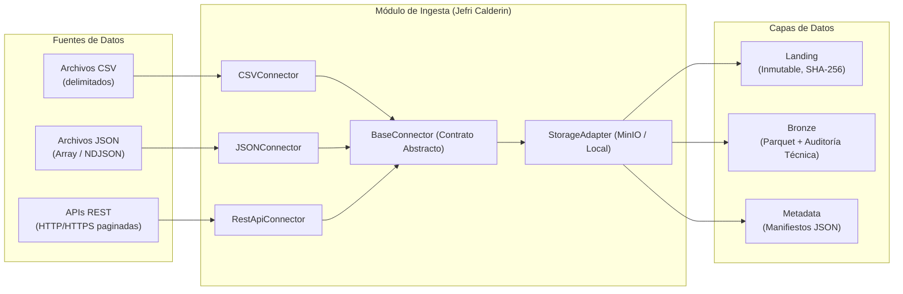

# Módulo de Ingesta y Conectores (Landing y Bronze)

> **Responsable:** Jefri Calderin  
> **Historias de Usuario:** US-03, US-04, US-05  
> **Pruebas de Aceptación Asociadas:** P01 (CSV), P02 (REST API), P03 (Archivos corruptos), T03.1, T03.2  

---

## 1. Visión General

Este módulo implementa el contrato de ingesta desacoplado y extensible para la plataforma de datos (Arquitectura Medallion). Permite la adquisición inmutable en la zona **Landing** y la normalización inicial con enriquecimiento de metadatos en la zona **Bronze** en formato Parquet comprimido con Snappy.



---

## 2. Componentes Entregados

| Componente | Archivo | Responsabilidad / Descripción |
| :--- | :--- | :--- |
| **Generador Mock Data** | `scripts/generate_mock_data.py` | Genera 1,000 clientes, 200 productos, 5,000 órdenes e ítems, devoluciones, datos anómalos para Quarantine y datasets Gold Parquet precocinados en <1 segundo. |
| **Contrato Base** | `ingestion/base_connector.py` | Define `BaseConnector(ABC)`, `IngestionConfig` e `IngestionResult` con el ciclo de vida: `configure()`, `validate()`, `fetch()`, `save_landing()`, `save_bronze()`, `emit_metadata()`. |
| **Conector CSV** | `ingestion/csv_connector.py` | Lectura por chunks, autodetección de delimitadores, hash SHA-256 inmutable en Landing y validación de columnas contra desfasaje (P01 / P03). |
| **Conector JSON** | `ingestion/json_connector.py` | Ingesta de JSON estructurado y JSON Lines (NDJSON) con aplanado columnar hacia Parquet. |
| **Conector REST API** | `ingestion/rest_api_connector.py` | Extracción con paginación (`page_number`, `offset_limit`, `cursor`), reintentos exponenciales con jitter (429, 500, 503) y credenciales seguras por variables de entorno (P02). |
| **Storage Adapter** | `ingestion/storage_adapter.py` | Manejador de persistencia para Landing, Bronze y metadatos con soporte MinIO / S3 y almacenamiento local. |
| **OpenAPI Mock Spec** | `data/mock/api/mock_sales_api.json` | Especificación OpenAPI 3.0 de la API REST externa de ventas. |
| **Batería de Pruebas** | `tests/unit/test_mock_data.py`, `tests/unit/test_connectors.py` | Pruebas unitarias automatizadas con cobertura total de los requerimientos T03.1, T03.2, T04.1, T04.2 y T05.1. |

---

## 3. Especificación Técnica de Metadatos y Auditoría

### 3.1 Columnas Técnicas en Capa Bronze
Cada fila registrada en Bronze contiene obligatoriamente:
- `_ingestion_id`: Identificador único UUIDv4 de la corrida.
- `_ingested_at`: Marca temporal UTC (ISO-8601).
- `_source_file`: Nombre del archivo o endpoint origen.

### 3.2 Manifiesto de Ingesta (Cuadro 4.2 del Documento Técnico)
Cada ejecución genera un manifiesto en `metadata/{YYYY}/{MM}/{DD}/{ingestion_id}_manifest.json`:
```json
{
  "ingestion_id": "8f8b0532-a5ec-4581-8092-23c8a9d18721",
  "source_id": "csv_sales_source",
  "source_type": "CSV",
  "dataset_name": "sales_transactions",
  "ingested_at": "2026-10-19T11:00:00.000000+00:00",
  "schema_version": "1.0.0",
  "status": "SUCCESS",
  "record_count": 5000,
  "landing_path": "storage/landing/csv_sales_source/2026/10/19/8f8b0532....csv",
  "bronze_path": "storage/bronze/sales_transactions/2026/10/19/8f8b0532....parquet",
  "sha256_hash": "284dd6b3ee43456cd07ef2f43ecef06bba4d39765e0bf8d8f5fb0ab8d48b7a40",
  "error_message": null,
  "execution_time_seconds": 0.45
}
```

---

## 4. Instrucciones de Uso

### 4.1 Generar Datos Sintéticos (US-03)
```bash
python scripts/generate_mock_data.py --records 5000 --customers 1000 --products 200
```

### 4.2 Ejecutar Conector CSV en Python
```python
from ingestion import CSVConnector, IngestionConfig

config = IngestionConfig(
    source_id="retail_orders",
    source_type="CSV",
    dataset_name="orders"
)
connector = CSVConnector(file_path="data/mock/raw/orders.csv", config=config)
result = connector.execute()
print(f"Estado: {result.status}, Filas: {result.record_count}")
```

### 4.3 Ejecutar Conector REST API en Python
```python
from ingestion import RestApiConnector, IngestionConfig

config = IngestionConfig(
    source_id="sales_api",
    source_type="REST_API",
    dataset_name="external_orders"
)
connector = RestApiConnector(
    base_url="https://api.empresa.com",
    endpoint="v1/orders",
    config=config,
    auth_type="bearer",
    token_env_var="SALES_API_TOKEN",
    pagination_type="page_number",
    page_size=100
)
result = connector.execute()
```

### 4.4 Ejecutar Suite de Pruebas Unitarias
```bash
python -m pytest tests/unit/ -v
```
